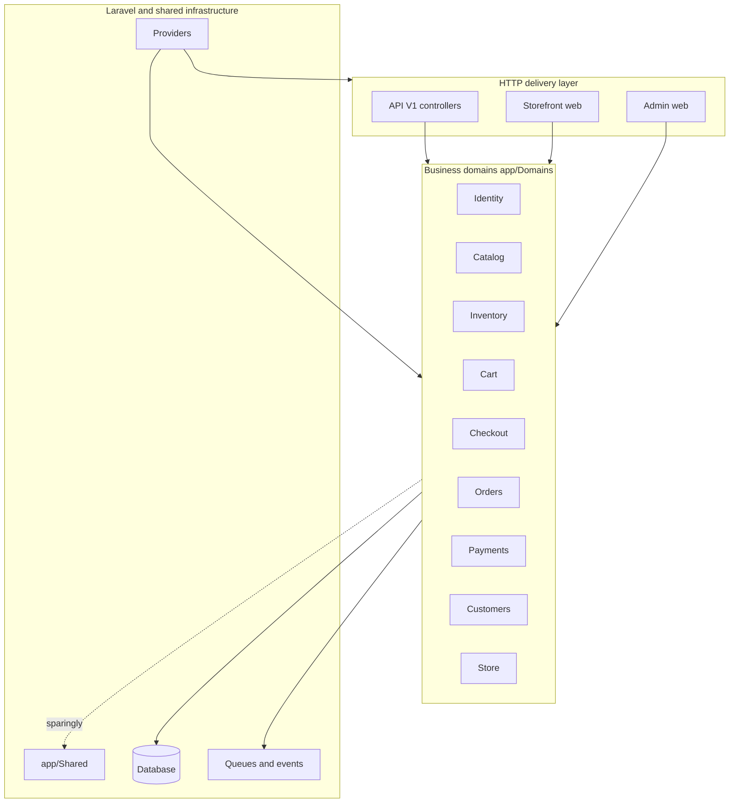
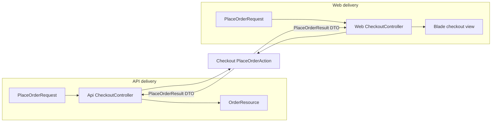
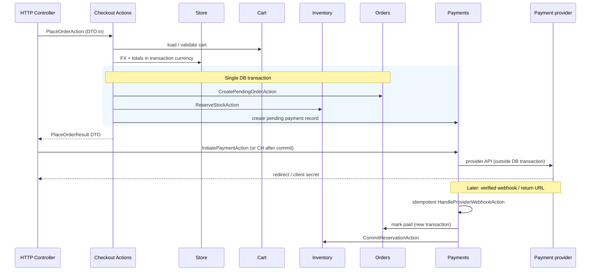

# Architecture

## Purpose

Single-store **clothing and fashion e-commerce** built as a **Domain-Oriented Modular Monolith** on Laravel 13. The design optimizes for clear boundaries, shared business logic across API and web channels, and the option to adapt the product model to other industries later—without adopting microservices or multi-tenancy upfront.

## High-level structure



### Three major areas

| Area | Path | Role |
| --- | --- | --- |
| Business domains | `app/Domains/*` | Models, Actions, domain Services, Events, Policies—everything that would still matter if we added a CLI or message consumer later |
| HTTP delivery | `app/Http/*`, `routes/*` | Controllers, Form Requests, API Resources, middleware, Blade—**transport and presentation only** |
| Shared | `app/Shared/*` | True cross-domain utilities, not a junk drawer |

`app/Providers/` remains the standard Laravel registration point. We avoid custom domain bootstrappers until a concrete binding or route group requires them.

## HTTP presentation rules (aligned with AGENTS.md)

- **Controllers** validate (Form Request), authorize (Policy / middleware), call domain **Actions** or **Queries**, then **map results** to JSON (API Resources), Blade views, or redirects.
- **Domain Actions must not** return API Resources, Blade views, `JsonResponse`, or HTTP status codes. They return DTOs, domain results, or throw domain exceptions.
- **API Resources** and **Blade** live under `app/Http/` and `resources/views/` only.
- **Storefront/admin presentation** (templates, CSS, layout) **must not** embed business rules—no price calculation, FX, stock checks, or checkout logic in views or ad hoc controller code.

## API and Web share business logic

Delivery channels are thin adapters. The same Action runs regardless of caller; **only controllers** differ in how the result is rendered.



**Example (target pattern, not yet implemented):**

- `App\Http\Controllers\Api\V1\CheckoutController` → `PlaceOrderAction` → `OrderResource`
- `App\Http\Controllers\Web\Storefront\CheckoutController` → same `PlaceOrderAction` → `storefront.checkout.success` view

## Currency (confirmed)

| Topic | Decision |
| --- | --- |
| Base currency | **USD** — catalog variant prices, shipping/tax baselines in settings |
| Additional supported currencies | **EGP**, **KWD** (display and transaction where enabled) |
| Exchange rates | **Store** domain; manual admin rows (USD → quote); see [DATABASE_DESIGN.md](DATABASE_DESIGN.md) |
| Display vs transaction | Independent; checkout uses explicit **transaction currency** |
| Historical records | `orders`, `order_items`, `payments`, `refunds` keep **frozen** currency, amounts, and `exchange_rate` |

**Rounding (MVP default, pending final approval):** Convert from USD using the order’s frozen rate; **round each money component** to the transaction currency’s `minor_units` (typically half-up); order `grand_total` = sum of rounded subtotal, tax, shipping, discounts. See [BUSINESS_WORKFLOWS.md](BUSINESS_WORKFLOWS.md).

## Locale, theme, and storefront preferences (ownership)

| Concern | Owning domain | Notes |
| --- | --- | --- |
| Supported locales, default locale, RTL rules | **Store** | Persisted with store settings (target); may bootstrap from config until `store_settings` exists |
| Supported themes, default theme | **Store** | Same |
| Customer active locale / theme / display currency | **Store** (Actions) + HTTP persistence | Controllers call e.g. `SetStorefrontLocalePreferenceAction`; session/cookie are delivery details |
| Product copy per locale | **Catalog** | `product_translations` (and category translations when added) |
| UI string catalogs (`lang/*` for chrome) | Delivery + Store defaults | Not product data |

Interim foundation code may use `config/localization.php` and HTTP middleware; **authoritative configuration** moves under **Store** when settings are implemented. See [LOCALIZATION_AND_THEMES.md](LOCALIZATION_AND_THEMES.md).

## Domain interaction during checkout (conceptual)

Checkout is an orchestration domain. It coordinates Cart, Inventory, Payments, Orders, Customers, and Store without owning their invariants.

**Not a universal rule:** The product does **not** mandate “payment always before order” or “order always before payment.” The exact step order **depends on the payment provider** (hosted checkout, authorize/capture, etc.). AGENTS.md requires designing the sequence per provider.

### Recommended MVP approach (pending order + stock reservation)

1. **Inside a short DB transaction:** validate cart, resolve customer, compute totals in **transaction currency** (Store), create **`pending_payment` order** with frozen FX snapshots, **reserve stock**, insert **pending** `payments` row (no gateway call yet).
2. **After commit:** `InitiatePaymentAction` calls the **payment provider** (HTTP/API)—**never inside** the transaction above.
3. **On verified success** (signed return URL and/or idempotent webhook): update payment, mark order paid/processing, **commit** stock, clear cart—in a **new** DB transaction.
4. **On payment failure (decline / abandon redirect):** mark payment and order `payment_failed`; **do not** release reservations— the customer may **retry payment on the same pending order** while reservations remain **active** (new `payments` row per attempt). **On cancellation or reservation expiry:** `ReleaseReservationAction` and cancel the order; `ExpireReservationsJob` handles TTL expiry for stale `pending_payment` / `payment_failed` orders.



**Idempotency:** `orders.idempotency_key`, `orders.public_uuid` for provider return URLs, `payments.idempotency_key`, and `payment_provider_events (provider, provider_event_id)` prevent duplicate orders and double processing. **No `checkout_sessions` table in MVP.**

**Recovery:** Failed payments **do not** auto-release reservations (retry on same order while stock is held). Duplicate webhooks → ignore. **Cancellation** or **reservation expiry** → release stock and cancel eligible orders. Payment captured locally but commit fails → reconciliation job. **Late payment success after reservation expiry** → reconciliation only—do not auto-confirm the order or commit stock (see BUSINESS_WORKFLOWS).

Final sequencing may be adjusted when the **payment provider** is chosen.

## Boundary rules

1. **Inward dependencies:** Domains may call another domain’s **public** entry points (Actions, Events, Contracts). Avoid importing another domain’s Models, internal Services, or Queries unless the team documents an exception.
2. **No circular graphs:** If Catalog needs Order history, prefer read Queries or Events over bidirectional Model imports.
3. **No repository-by-default:** Eloquent models and Query classes are enough unless testing or swapping storage demands a Contract.
4. **Single store:** **Store** domain holds settings (currency, locales, themes, contact, tax/shipping baselines). No tenant resolver.

## Laravel integration

| Concern | Decision |
| --- | --- |
| **Autoloading** | PSR-4 `App\` → `app/` (includes `Domains`, `Http`, `Shared`) |
| **Routing** | `bootstrap/app.php` registers `routes/web.php` and `routes/api.php` (API prefix `/api`) |
| **Authentication** | Laravel session guard; user model `App\Domains\Identity\Models\User` (`config/auth.php`, overridable via `AUTH_MODEL`) |
| **Authorization** | Policies registered in `AppServiceProvider` or dedicated provider when added |
| **Eloquent** | Domain models live under each domain; migrations remain in `database/migrations/` |
| **Events / listeners** | Colocated in domains; standard Laravel discovery or explicit registration |
| **Jobs / queues** | Domain Jobs when needed (e.g. expire reservations, payment reconciliation) |
| **Transactions** | Multi-table **domain** state changes in `DB::transaction()`; **payment provider HTTP** outside transactions |
| **Configuration** | Framework in `config/*`; store, currency, locale, and theme defaults in **Store** domain data when implemented |
| **Providers** | Default `AppServiceProvider`; Contract bindings only when needed |

## Fashion-specific modeling (planned)

Not implemented in the foundation phase; ownership is fixed early to avoid rework.

| Concept | Owning domain | Notes |
| --- | --- | --- |
| Product, collection, variant | **Catalog** | Parent product; variants carry size/color attribute values |
| Product translations | **Catalog** | Localized name/description per locale |
| Size / color attributes | **Catalog** | Enums or attribute tables; display labels for storefront |
| SKU | **Catalog** | Unique per variant; stable identifier for integrations |
| Variant price (USD) | **Catalog** | Base currency; converted for display/checkout via **Store** |
| Stock quantity | **Inventory** | Per variant/SKU; separate from merchandising data |
| Stock reservation | **Inventory** | During checkout; stays **active** after ordinary payment failure (retry on same order); released on **order cancellation** or **TTL expiry** (`ExpireReservationsJob`) |
| Images | **Catalog** | Storage paths or media library integration later |
| Cart lines | **Cart** | Reference variant SKU, qty, USD base snapshot |
| Order lines | **Orders** | Snapshot catalog + transaction currency amounts at purchase time |

**Catalog ↔ Inventory collaboration:**

- Catalog defines **what** is sold (variant id, SKU, attributes, USD price).
- Inventory defines **how many** can be sold and **reservation** lifecycle.
- Checkout asks Inventory to validate/reserve using **variant id** / SKU—Inventory does not duplicate attribute definitions.

## HTTP directory map (current foundation)

```
app/Http/Controllers/Api/V1/          # e.g. HealthController (foundation)
app/Http/Controllers/Web/Storefront/  # e.g. home, preferences (presentation only)
app/Http/Controllers/Web/Admin/       # reserved
app/Http/Requests/Api/
app/Http/Requests/Web/
app/Http/Resources/
app/Http/Middleware/
```

## What exists today vs planned

| Item | Status |
| --- | --- |
| Domain root folders | Created (minimal) |
| Identity `User` model | Moved to `app/Domains/Identity/Models/` |
| API health endpoint | `GET /api/v1/health` |
| Storefront locale/theme switcher | HTTP + config (interim); Store domain settings planned |
| Business Actions (checkout, catalog, etc.) | Not implemented |
| Product / order migrations | Not implemented |

## Related documents

- `docs/DATABASE_DESIGN.md` — schema, currency tables, translations
- `docs/DOMAIN_DATA_OWNERSHIP.md` — table ownership, cross-domain rules
- `docs/BUSINESS_WORKFLOWS.md` — checkout, payment, FX workflows
- `docs/DOMAIN_MAP.md` — domain responsibilities
- `docs/PROJECT_ROADMAP.md` — phased delivery plan
- `docs/DATABASE_DESIGN_APPROVAL_REPORT.md` — schema approval and migration readiness
- `AGENTS.md` — coding and review rules
