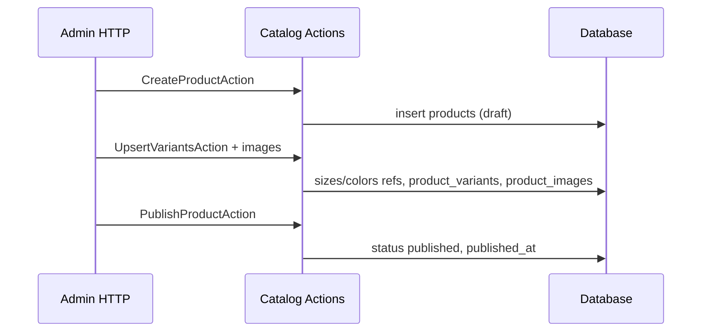
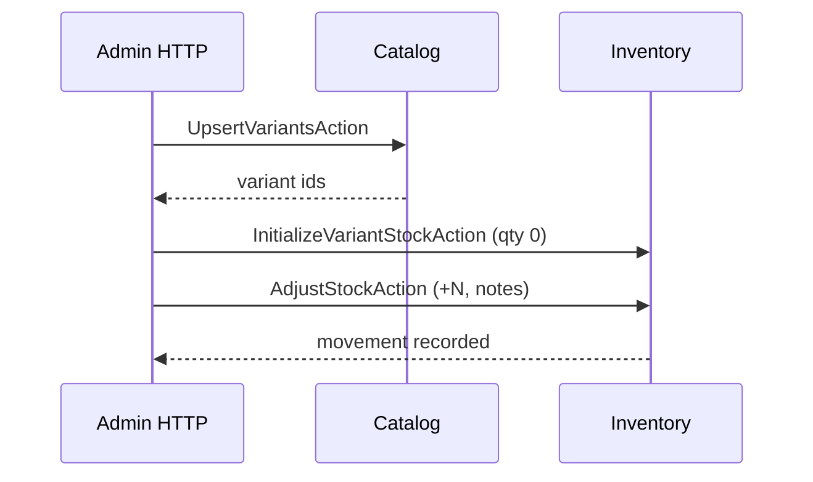
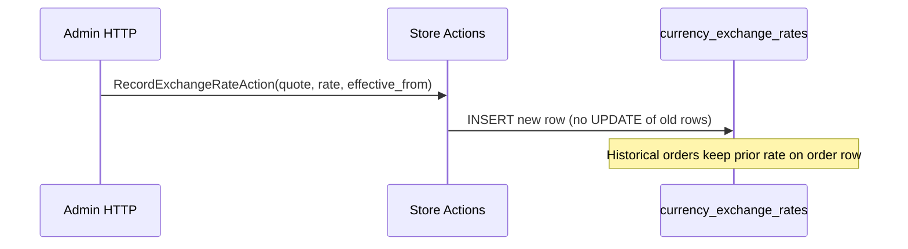
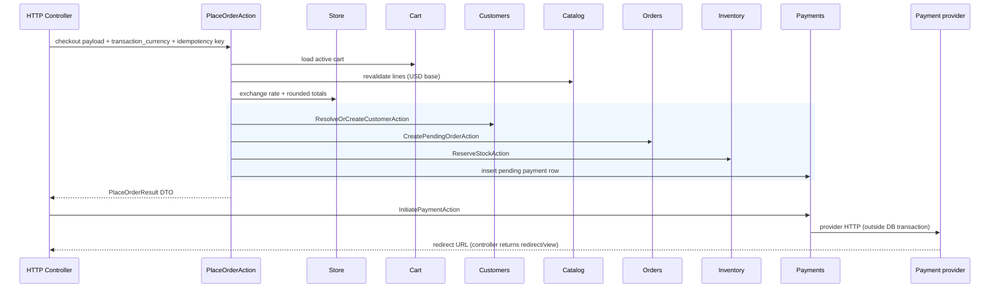
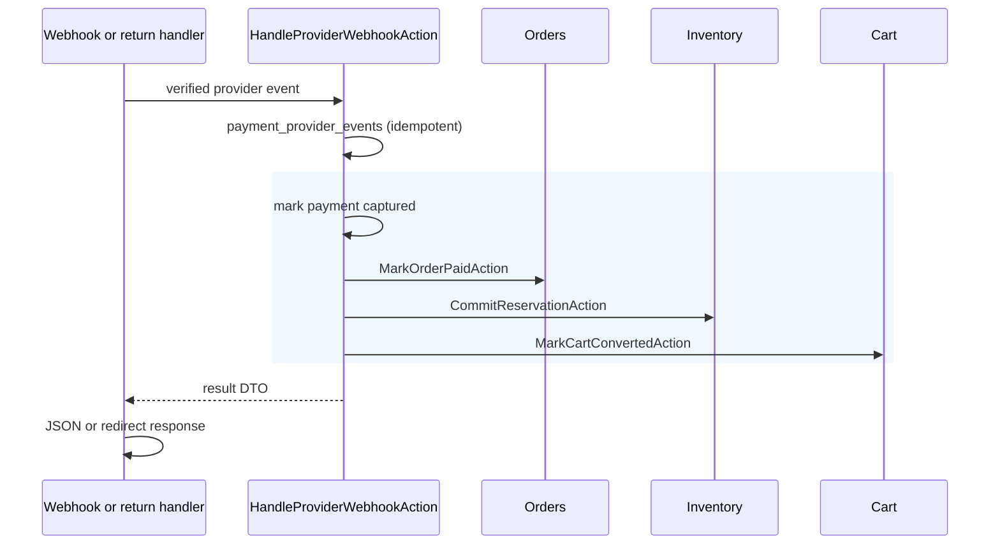

# Business workflows

End-to-end flows for the fashion store MVP, including **transaction boundaries**, **failure handling**, **checkout strategy**, and **multi-currency rules**. All workflows assume server-side price, FX, and stock authority (see AGENTS.md).

## Currency rules (confirmed)

| Topic | Rule |
| --- | --- |
| Base / catalog prices | **USD** on `product_variants.price` |
| Supported currencies | **USD**, **EGP**, **KWD** |
| Exchange rates | Admin-managed manual rows (`currency_exchange_rates`); quote per 1 USD |
| Display | Customer selects **display currency** for browsing (cart UI, PLP/PDP); independent of payment |
| Checkout | Customer selects **transaction currency** explicitly (`transaction_enabled`) |
| Orders / payments | Persist amounts in **transaction currency** + frozen `exchange_rate`; never updated when rates change |
| Shipping / tax baselines | Stored in USD on `store_settings`, converted at checkout using the **same order rate** |
| Historical immutability | Never recompute past orders when rates or defaults change |

### Exchange-rate and rounding policy (MVP default)

- **Rate direction:** `currency_exchange_rates.rate` = quote currency units per **1 USD**.
- **Source of truth at checkout:** Server loads current rate for the selected **transaction currency**; missing rate blocks checkout for that currency.
- **Rounding:** **Half-up** to `currencies.minor_units` for each converted component (line subtotals, tax, shipping). Order `grand_total` is the sum of rounded components in **transaction currency**—not a silent re-round of the USD total.
- **Snapshots:** Store `orders.exchange_rate`, `orders.currency_code`, and all charge amounts on the order and on `payments` / `refunds`.

**Tax:** Deferred until jurisdiction confirmed (`tax_enabled` default off). Shipping: USD baseline → converted once per order.

**Provider constraint:** Transaction currency at checkout must be both `transaction_enabled` in Store config **and** supported by the chosen payment provider.

---

## Recommended MVP checkout strategy

**AGENTS.md:** Do not assume payment must always happen before or after order creation. The tables below compare patterns; **implementation must follow the chosen payment provider**.

### Options considered

| Strategy | Sequence | Pros | Cons |
| --- | --- | --- | --- |
| **A. Pay then reserve** | Payment → create order → reserve stock | Simple mental model | Oversell risk if payment succeeds under concurrency |
| **B. Order then pay (no reserve)** | Create order → payment → deduct stock on success | Fewer reservation tables | Race on last units during payment redirect |
| **C. Reserve → pending order → pay → commit** | Hold stock → create `pending_payment` order → payment → commit | Strong oversell protection | Expiry jobs; must release on **cancellation** or **TTL expiry** (not on ordinary payment failure—retries while active) |
| **D. Authorize payment then reserve** | Auth card → reserve → capture | Good for card auth | Provider-dependent; complex |

### Recommendation for MVP: **Strategy C** (pending order + reservation first)

This is the **default target** for a single-store MVP with manual FX and hosted/redirect payments. **Adjust** if the provider requires authorize-before-order or other flows.

1. Customer submits checkout with addresses and explicit **transaction currency** (display currency may differ).
2. **Checkout** revalidates cart (Catalog USD prices, variant active, published).
3. **Store** supplies current exchange rate for transaction currency; fails if rate missing for EGP/KWD.
4. **Checkout** computes rounded totals in **transaction currency**.
5. **Inside one database transaction** (no external payment API calls):
   - **Customers:** `ResolveOrCreateCustomerAction`.
   - **Orders:** `CreatePendingOrderAction` — `pending_payment`, frozen `currency_code`, `exchange_rate`, line snapshots.
   - **Inventory:** `ReserveStockAction` per line, `order_id`, `expires_at` from store TTL.
   - **Payments:** insert **pending** `payments` row matching order amount/currency (record only).
6. **After transaction commits:** `InitiatePaymentAction` invokes the **payment provider** (HTTP) and returns redirect/session data to the **HTTP controller** (DTO—not a view).
7. On **verified success** (return URL signature check and/or idempotent webhook):
   - **New DB transaction:** mark payment captured, order → `processing`, `CommitReservationAction`, `MarkCartConvertedAction`.
8. On **failure / abandon:** `RecordPaymentFailureAction`, order → **`payment_failed`**, `ReleaseReservationAction` **only if** abandoning retry; otherwise keep reservation for retry (see below).
9. **Scheduled job:** `ExpireReservationsJob` — release stock, cancel or expire stale `pending_payment` orders.

**Provider caveat:** If the gateway must authorize before an order exists, introduce a provider-specific adapter under **Payments** and document the variant in implementation—without changing historical order snapshots.

### Idempotency and verified callbacks

| Mechanism | Purpose |
| --- | --- |
| `orders.idempotency_key` | Duplicate “Place order” submits with the **same payload** |
| `payments.idempotency_key` | Duplicate payment initiation / retries |
| `payment_provider_events` UNIQUE `(provider, provider_event_id)` | Duplicate webhooks |
| Provider signature / amount verification | Untrusted callbacks until verified |

Replays with the **same** idempotency key and **equivalent** checkout payload return the existing in-progress checkout or success state without double-charging or double-reserving.

**Place-order idempotency conflict:** Reusing `orders.idempotency_key` with a **different** checkout payload (cart lines, addresses, transaction currency, or other material fields) returns **HTTP 409 Conflict**—do not create a second order.

**Payment retries:** Stay on the **same** pending order. Each retry creates a **new** `payments` row (`attempt_number` incremented, new `payments.idempotency_key`), preserving full per-attempt history on the order.

### Payment failure, reservation expiry, and recovery

| Scenario | Handling |
| --- | --- |
| Payment declined | `payments.status = failed`; order **`payment_failed`**; **do not** release reservations; **retry** new `payments` row on **same order** while reservation **active** |
| Customer abandons redirect | Order `payment_failed`; reservation **remains active** for retry until TTL (not released on failure alone) |
| Customer or admin **cancellation** | Order **`cancelled`**; `ReleaseReservationAction` for active reservations |
| Reservation TTL expires | `ExpireReservationsJob` releases stock; order **`cancelled`**; customer must start **new** checkout (`new idempotency_key` / new order) |
| Retry after expiry | **Not allowed** on same order—prevent duplicate captures by enforcing reservation state on `InitiatePaymentAction` |
| Late payment success after reservation expired | Order already **`cancelled`**; stock released. Handler must **not** auto-confirm order or `CommitReservationAction`. Route to **reconciliation** (ops alert; provider void/refund per runbook) |
| Webhook before browser return | Idempotent handler updates order; redirect shows success |
| Capture succeeded, DB commit fails | **Reconciliation job** + alert; never re-run capture blindly |
| Admin changes FX rate | Affects **new** checkouts only; orders/payments unchanged |

**Retry limits:** Application policy (e.g. max attempts)—not schema.

---

## Transaction boundaries

| Step | Transaction scope | Notes |
| --- | --- | --- |
| Add to cart | Single cart row + item | USD `unit_price_base` snapshot from Catalog |
| Switch display currency | Session / cart column | No order impact |
| Place order (core) | Customer + order + items + reservations + pending payment **row** | Frozen FX; **no provider HTTP** |
| Payment initiation | Provider API only | **After** place-order transaction commits |
| Payment webhook / verified return | Payment update + order status + commit stock + cart | **One transaction**; idempotent |
| Start checkout | Session row | Optional |
| Admin stock adjust | Movement + level | One transaction |
| Admin status change | Order status + history | One transaction |

Payment provider calls happen **outside** DB transactions; persist state transitions after verified response.

---

## Workflow: Admin creates a product

**Inventory:** Not automatic in Catalog. Admin follows with **Add variant stock** workflow (below).

**Failure:** Validation errors on duplicate SKU or invalid category; no partial publish without variants (business rule: at least one active variant—**assumption**).

---

## Workflow: Admin adds variants and stock

**Ownership:** Catalog creates variant; Inventory creates `inventory_levels` and movements.

**Alternative:** Single admin “Save product” controller calls both Actions sequentially; rollback on failure if second step fails (compensating delete variant is heavy—prefer transaction only within each domain, then show admin error).

---

## Workflow: Customer browses products

- **Storefront/API** → Catalog Queries (`ListPublishedProductsQuery`, `GetProductBySlugQuery`) returning **USD** prices.
- **Store** → `ConvertUsdToCurrencyAction` for **display currency** (session/cookie/customer preference); conversion is **read-only**.
- Join **Inventory** `GetAvailableQuantityQuery` for “in stock” badge (read-only; may be cached).
- No cart or checkout involvement.

---

## Workflow: Customer selects display currency

1. Customer picks USD, EGP, or KWD in storefront switcher (separate from language switcher).
2. HTTP controller calls **Store** `SetDisplayCurrencyPreferenceAction` (validates against `currencies`); persists session/cookie; registered users may save on `customers.preferred_display_currency_code`.
3. **Cart** updates `display_currency_code` on active cart via `SetCartDisplayCurrencyAction`.
4. PLP/PDP/cart totals re-render using latest **admin** exchange rate (not client-supplied).
5. **Does not** change `cart_items.unit_price_base` (USD).

---

## Workflow: Admin manages exchange rates

- Admin enters USD→EGP and USD→KWD rates.
- Optional `notes` and future `effective_from` scheduling.
- **Orders domain never reads live rates** for past orders—only order snapshots.

---

## Workflow: Customer adds variant to cart

**Implemented (Phase 3 — domain only):** `AddCartItemAction`, `UpdateCartItemQuantityAction`, and `RemoveCartItemAction` are implemented. They accept a trusted `Cart` model (no HTTP in this layer).

**Implemented (Phase 4 — HTTP/session):** Storefront cart routes, `GetOrCreateCartAction`, guest `session_token` in Laravel session (`cart_session_token`), checkout resolves cart from session, and `CartMutationException` mapped to **422** / **404** HTTP responses. Display currency on new carts uses `ResolveDisplayCurrencyCodeQuery` (store default until preference UI exists).

### Add

1. Caller invokes `AddCartItemAction` with `product_variant_id`, `quantityDelta`, and `contentLocale` (today: direct Action call or tests; Phase 4: HTTP controller after cart resolution).
2. Cart → Catalog: `ResolveVariantForCartLineQuery` (active variant, `published` product, en+ar and content-locale translations).
3. Cart → Inventory: `GetAvailableQuantityForVariantsQuery` enforces `max(0, on_hand - reserved)` on add and update (no reservation).
4. Cart upserts `cart_items` with **USD `unit_price_base`** and localized snapshots from Catalog (merge duplicate variants per unique constraint).

### Update

`UpdateCartItemQuantityAction` revalidates sellability, stock, and refreshes snapshots. Quantity must be ≥ 1 (use remove to delete a line).

### Remove

`RemoveCartItemAction` deletes the line without catalog or stock checks so customers can clear items even when a product became unpublished or out of stock. Requires an **active** cart (including expired active carts); converted/abandoned carts are rejected.

### Failure

Unavailable variant or insufficient stock → domain `CartMutationException` with stable error codes. HTTP 422 mapping is **Phase 4**. Checkout reservation remains the final stock protection.

---

## Workflow: Customer checks out (place order)

See Strategy C diagram:

**Duplicate submit:** Same `orders.idempotency_key` **and equivalent payload** returns existing pending order / in-progress payment (no double order). Same key with different payload → **HTTP 409 Conflict**.

---

## Workflow: Payment succeeds

**Triggers:** Customer return URL (verify with provider) **and/or** async webhook (source of truth when available).

**Already processed event:** Second webhook → `ignored`, 200 OK. Handler must **verify** signature and amounts before the DB transaction.

---

## Workflow: Payment fails

1. Provider signals failure or customer abandons redirect.
2. `RecordPaymentFailureAction` → `payments.status = failed`.
3. `Orders` → **`payment_failed`** (retain order for support and retry).
4. **Keep** active `inventory_reservations` so the customer can retry without re-checkout while TTL allows.
5. Customer **retries** via `InitiatePaymentAction` → new `payments` row (`attempt_number++`, new `idempotency_key`) on the **same order** while reservations are **active** and status ∈ (`pending_payment`, `payment_failed`).
6. **`ReleaseReservationAction`** only when the business policy explicitly cancels the order, or when `ExpireReservationsJob` runs (then order → `cancelled`; new checkout required).

**Retry limits:** Application rule (e.g. max attempts)—not schema.

---

## Workflow: Customer views an order

- Policy: `user_id` matches or `customer_id` linked to authenticated customer; guest link via signed URL or login email match (**MVP:** require login or email verification magic link—**assumption:** logged-in only for order history; guest sees confirmation page once).

---

## Workflow: Admin updates order status

1. `TransitionOrderStatusAction` with `from_status` validation (state machine).
2. Insert `order_status_histories`.
3. Optional: notify customer (Event `OrderStatusChanged`).

**Statuses MVP:** `pending_payment` → `processing` → `shipped` → `delivered`; branches `cancelled`, `payment_failed`, `refunded`.

---

## Workflow: Stock reserved, committed, released

| Event | Inventory operation | `inventory_levels` | `inventory_reservations` |
| --- | --- | --- | --- |
| Place order | Reserve | `quantity_reserved` += qty | `active` |
| Payment success | Commit | `on_hand` -= qty, `reserved` -= qty | `committed` |
| Payment failure (`payment_failed`) | Hold (retry) | No change | `active` (same order; new `payments` row while active) |
| Order cancellation | Release | `reserved` -= qty | `released` |
| TTL expired (job) | Expire / release | `reserved` -= qty | `expired` |
| Admin adjustment | Adjust | `on_hand` += delta | — |

Each change logs `inventory_movements`.

**Overselling prevention:** Reservation fails if `available < requested` inside locked transaction; checkout aborts, no order created (or order rolled back in same transaction).

---

## Concurrent checkout (two customers, one unit)

1. Customer A and B both checkout last unit.
2. First transaction reserves 1 → success, order pending.
3. Second transaction reserve → **insufficient** → rollback; user sees out-of-stock message.
4. If A’s payment fails, A’s reservation **stays active** until TTL or cancel; B cannot take the unit while A holds it. If A’s reservation **expires or is cancelled**, B may succeed on a new checkout.

---

## Guest checkout representation

| Field | Guest | Registered |
| --- | --- | --- |
| `customers.user_id` | NULL | set |
| `orders.user_id` | NULL | set |
| `orders.guest_email` | set | optional copy |
| `orders.customer_id` | set | set |
| Addresses | JSON snapshot on order + optional save to `customer_addresses` if checkbox “save details” |

**Later account association:** Register/login → link `customers.user_id` → Policy grants access to past `orders.customer_id`.

---

## Failure scenario checklist

| Scenario | Expected behavior |
| --- | --- |
| Double-click Place Order | Idempotency returns same payment session (same key + same payload) |
| Same place-order idempotency key, different payload | **HTTP 409 Conflict** |
| Payment retry | Same order; new `payments` row (`attempt_number++`); prior attempts retained |
| Duplicate webhook | Ignored via `payment_provider_events` |
| Webhook before redirect | Order paid; redirect shows success |
| Payment success, commit fails | **Critical:** retry job; alert ops; payment captured flag vs stock mismatch—manual reconciliation |
| Reservation expires while paying | `ExpireReservationsJob` releases stock; order **cancelled**; provider capture should fail or void where possible |
| Late payment success after reservation expired | **Reconciliation only**—no auto order confirm, no stock commit |
| Admin deletes variant with orders | FK SET NULL on `order_items.product_variant_id`; snapshots retain sku/name |
| Catalog price changes mid-cart | `RefreshCartPricesAction` at checkout or place order |
| Display currency = EGP, pay in USD | Checkout `transaction_currency_code` = USD; order stored in USD |
| Admin updates EGP rate after order placed | Old orders unchanged; new checkouts use new rate |
| No EGP rate configured | Checkout in EGP blocked with admin-visible error |
| Client submits forged FX or totals | Ignored; server computes from USD base + Store rate |

---

## Related documents

- [DATABASE_DESIGN.md](DATABASE_DESIGN.md)
- [DOMAIN_DATA_OWNERSHIP.md](DOMAIN_DATA_OWNERSHIP.md)
- [MVP_SCOPE.md](MVP_SCOPE.md)
