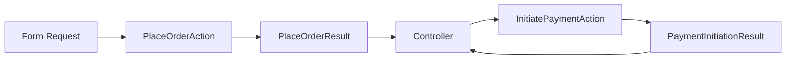
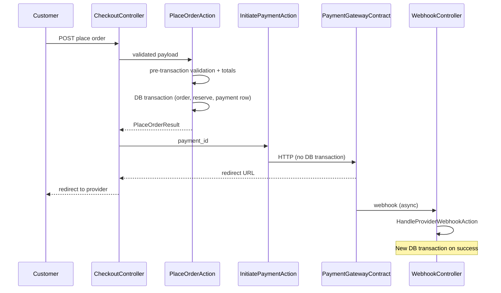

# Checkout workflow design (Strategy C)

**Date:** 2026-11-13
**Branch:** `feature/checkout-workflows`
**Status:** Implementation-ready design (no code in this task)
**Companion:** [CHECKOUT_AUDIT_REPORT.md](CHECKOUT_AUDIT_REPORT.md)

Approved baseline: **pending order + inventory reservation first**, then **payment provider after DB commit**, no `checkout_sessions`, idempotent place order and webhooks.

---

## 1. Architecture and component responsibilities

### Principles

- **Checkout** = orchestration only (`app/Domains/Checkout/Actions/`, DTOs in `app/Domains/Checkout/DTOs/` or `app/Shared/` if truly cross-cutting).
- **No Eloquent workflow logic** in models.
- **No payment provider HTTP** inside `DB::transaction()`.
- Actions are **single-purpose**; `PlaceOrderAction` coordinates other domain Actions (does not duplicate their rules).

### Recommended components (minimal MVP)

| Component | Location | Responsibility |
| --- | --- | --- |
| `PlaceOrderRequest` (Form Request) | `app/Http/Requests/Web/` | Validate addresses, `transaction_currency_code`, `content_locale`, `idempotency_key`, guest email, optional `customer_address_id` references |
| `RetryPaymentRequest` | `app/Http/Requests/Web/` | Validate order ownership + new payment idempotency key |
| `PlaceOrderAction` | Checkout | Saga entry: idempotency, pre-checks, totals, single DB transaction, returns `PlaceOrderResult` |
| `PlaceOrderResult` | Checkout DTO | `order_id`, `public_uuid`, `payment_id`, `grand_total`, `currency_code` (no view data) |
| `ComputeCheckoutTotalsAction` or `CheckoutTotalsCalculator` | Store or Checkout | Given USD line bases + store settings + FX row: transaction currency totals (half-up). Prefer **Store-owned** rate lookup + calculator invoked by Checkout. |
| `ResolveCurrentExchangeRateQuery` | Store | Latest `currency_exchange_rate` for quote currency (USD → 1.0) |
| `ResolveOrCreateCustomerAction` | Customers | Guest/register paths; optional save addresses |
| `RefreshCartPricesAction` | Cart | Sync USD bases from Catalog before totals |
| `ValidateCartForCheckoutAction` | Cart or Checkout | Active cart, non-empty, ownership |
| `CreatePendingOrderAction` | Orders | Order + items + initial status history |
| `CreatePendingPaymentAction` | Payments | Row attempt 1, `pending`, amount/currency from order |
| `ReserveStockForOrderAction` | Inventory | Lock levels, create reservations, movements |
| `InitiatePaymentAction` | Payments | After commit: gateway call, update `provider_*` on **existing** pending payment (or create row for retry — see §3.C) |
| `PaymentGatewayContract` | Payments Contract | `initiateCheckout(Payment $payment, Order $order): PaymentInitiationResult` |
| `HandleProviderWebhookAction` | Payments | Idempotent event ingest + domain transitions |
| `CompletePaymentSuccessAction` | Checkout or Payments | Orchestrates post-success transaction (payment captured, order paid, commit stock, cart converted) |
| `RecordPaymentFailureAction` | Payments | Mark payment failed; transition order → `payment_failed` |
| `ReleaseReservationAction` | Inventory | On cancel / expiry / explicit abandon (not ordinary decline) |
| `CommitReservationAction` | Inventory | On captured payment |
| `MarkCartConvertedAction` | Cart | `status = converted` |
| `ExpireReservationsJob` | Inventory | Scheduled TTL processing |
| `ReconcileOrphanCaptureJob` | Payments (deferred) | Provider captured but local commit failed |
| Policies | Orders, Cart | Customer can place/retry own order |
| Controllers | `Http/Controllers/Web/Storefront/` | Call Actions only; map DTOs to redirect/Blade |

### Defer or avoid (MVP)

| Item | Reason |
| --- | --- |
| Generic saga framework | Laravel transactions + Actions sufficient |
| Repository layer | Eloquent + Actions per AGENTS.md |
| Events on critical path | Sync Actions first; `OrderPaid` optional for email later |
| `checkout_sessions` table | Explicitly out of MVP |
| Refund Actions | Tier 2 / no table |

### DTO flow



---

## 2. End-to-end checkout sequence

### Overview



### Phase A — Before database transaction (safe preparation)

Work that can run **without** locks; failures return 4xx without side effects.

| Step | Action / check | Owner |
| --- | --- | --- |
| A1 | Authenticate or resolve guest session + cart token | Identity + Cart |
| A2 | Load **active** cart for owner; reject `converted` / `abandoned` | Cart |
| A3 | Reject empty cart | Cart |
| A4 | Cart not expired (`expires_at` null or future) | Cart |
| A5 | `guest_checkout_enabled` if guest | Store settings |
| A6 | `RefreshCartPricesAction` — refresh USD bases from Catalog | Cart → Catalog |
| A7 | Each line: variant **active**, product **published**, both **en** and **ar** translations exist | Catalog |
| A8 | Soft-delete / archived product → reject | Catalog |
| A9 | `transaction_currency_code`: exists, `transaction_enabled` | Store |
| A10 | Resolve FX: USD rate 1; EGP/KWD require rate row at or before now | Store |
| A11 | `content_locale` valid active `store_locales` | Store |
| A12 | Compute totals: lines, shipping (`shipping_enabled`, flat USD, free threshold), tax **0** if `tax_enabled` false | Store + Checkout |
| A13 | Validate shipping/billing address structure (Form Request) | HTTP |
| A14 | Registered: customer belongs to user; guest: email required | Customers |

**Must revalidate inside transaction (race-sensitive):**

| Item | Why |
| --- | --- |
| Catalog USD price per line | Price change between A6 and commit |
| Variant/product sellability | Unpublish mid-flow |
| Available stock | Concurrent purchasers |
| FX row selection | Optional: re-read rate id inside transaction and freeze that row (new checkouts only; same order on idempotent replay uses existing snapshot) |
| Cart still active and unchanged line set | Cart modification during checkout |

**Idempotency short-circuit (before transaction):**

- If client sends `idempotency_key` and an order exists with that key:
  - If status ∈ (`pending_payment`, `payment_failed`) and reservations still **active** → return existing `PlaceOrderResult` (no new reservation).
  - If status `processing`+ / cancelled → return appropriate HTTP state (already completed / cannot replay).
  - If same key but **payload hash differs** (addresses, currency, cart) → **HTTP 409 Conflict** (MVP rule; see `BUSINESS_WORKFLOWS.md`).

---

### Phase B — Inside database transaction (place order core)

**Single `DB::transaction()`** wrapping all rows below. **No external I/O.**

Recommended **order of operations** (respects FKs and failure rollback):

```text
1. Idempotency row lock (optional): SELECT orders WHERE idempotency_key = ? FOR UPDATE
   - If found → return mapped result (or skip creation steps)
2. Revalidate cart lines (count, variant ids, qty) and catalog sellability
3. Recompute totals with fresh catalog USD prices (same rules as Phase A)
4. ResolveOrCreateCustomerAction (may INSERT customer)
5. CreatePendingOrderAction
      - status pending_payment
      - frozen base_currency_code USD, currency_code, exchange_rate*, ids, totals
      - JSON addresses, content_locale, public_uuid, order_number, idempotency_key
      - order_items snapshots (unit_price_base_usd, unit_price, line_subtotal)
      - order_status_histories: null → pending_payment
6. For each distinct product_variant_id in order (sorted by variant id ascending):
      a. SELECT inventory_levels WHERE product_variant_id = ? FOR UPDATE
      b. Verify (on_hand - reserved) >= qty
      c. INSERT inventory_reservations (active, order_id, cart_id, expires_at = now + TTL)
      d. UPDATE quantity_reserved += qty
      e. INSERT inventory_movement (reservation_hold)
7. CreatePendingPaymentAction
      - attempt_number = 1
      - amount = orders.grand_total, currency_code = orders.currency_code
      - status pending, new payments.idempotency_key (distinct from order key)
8. Optional: cart remains active until payment success (recommended per MarkCartConverted on success only)
```

**Lock strategy**

| Row / table | Lock | Purpose |
| --- | --- | --- |
| `inventory_levels` per variant | `SELECT ... FOR UPDATE` | Serialize reserve; prevent oversell |
| Variant order | Sort variant IDs ascending | Deadlock avoidance when locking multiple lines |
| Existing order by idempotency key | `FOR UPDATE` when replay-safe | Prevent duplicate order creation |

**Optimistic alternative:** `inventory_levels.version` increment with retry — documented as alternative in `DOMAIN_DATA_OWNERSHIP.md`; **MVP recommendation remains pessimistic row lock**.

**Rollback:** Any failure → full rollback; no order, no reservations, no payment row.

**Linking cart ↔ order:** No `orders.cart_id`. Use `inventory_reservations.cart_id` + business logic; `MarkCartConvertedAction` uses cart from checkout context.

---

### Phase C — After transaction commit (payment initiation)

| Step | Detail |
| --- | --- |
| C1 | Load `Payment` created in step B7 (`status = pending`, latest for order if idempotent replay skipped B7). |
| C2 | `InitiatePaymentAction` verifies order status ∈ (`pending_payment`, `payment_failed`) for retries; for first initiation, `pending_payment` only. |
| C3 | Verify reservations **active** and not expired (retry gate). |
| C4 | Call `PaymentGatewayContract::initiateCheckout()` with `orders.public_uuid`, amount, currency, metadata. |
| C5 | On provider response **success**: update `payments.provider`, `provider_payment_id`, `provider_checkout_url` in a **short separate transaction** (or single UPDATE autocommit). |
| C6 | Return `PaymentInitiationResult` (redirect URL, optional client token) to controller. |

**Provider request failure (network/5xx):**

- Payment row stays `pending` (or mark `failed` only if provider returns definitive failure — policy in Payments Action).
- Order stays `pending_payment`.
- Reservations remain.
- Customer can retry initiation with same payment row or new attempt per product decision.

**Provider success, app crashes before persisting provider ids:**

- Reconciliation: poll provider by `metadata` / `public_uuid` or rely on webhook.
- **Do not** call initiate again with same `payments.idempotency_key` if provider treats idempotency strictly — use provider lookup first.

**Retries (payment_failed):**

1. `RecordPaymentFailureAction` already ran → order `payment_failed`, payment `failed`; reservations **remain active** (not released on failure).
2. Customer calls retry endpoint on the **same order** (no new place order).
3. **New** `payments` row: `attempt_number++`, **new** `payments.idempotency_key`; prior attempt rows remain as history on the order.
4. `InitiatePaymentAction` on the new row — **no** new place-order transaction.
5. Enforce: reservations `active`, order status ∈ (`pending_payment`, `payment_failed`), not expired.

**Duplicate charge prevention:**

- Unique `payments.idempotency_key` per initiation attempt.
- Unique `(provider, provider_payment_id)` when set.
- Webhook handler refuses second capture for same payment.

---

## 3. Payment callback workflow

Entry: `HandleProviderWebhookAction` (HTTP controller validates HTTP shape only).

| Step | Action |
| --- | --- |
| W1 | Parse payload; **provider adapter** verifies signature (implementation-specific). |
| W2 | Insert `payment_provider_events` with `(provider, provider_event_id)` — on duplicate unique violation, return **200 OK**, `processing_result = ignored` (idempotent). |
| W3 | Resolve `Payment` by `provider_payment_id` and/or metadata (`public_uuid`, `order_number`). |
| W4 | If no payment match: store event with `payment_id = null`; `processing_result = ignored` or `error` + ops alert; **no order mutation**. |
| W5 | Verify **amount** and **currency_code** match `orders.grand_total` and `orders.currency_code` (decimal string compare). |
| W6 | If payment already `captured` → ignore duplicate success. |
| W7 | **Success path** — new `DB::transaction()` |
| W7a | Update payment → `captured` (or `authorized` then capture if two-step); set timestamps |
| W7b | Orders: `MarkOrderPaidAction` → `processing`, `paid_at`, status history |
| W7c | `CommitReservationAction` per reservation |
| W7d | `MarkCartConvertedAction` |
| W7e | Update `payment_provider_events.processed_at`, `processing_result = success` |
| W8 | **Failure path** — `RecordPaymentFailureAction`; order `payment_failed`; **do not** release reservations (retry policy) |

**Return URL handler:** May share core with webhook via `CompletePaymentSuccessAction` after provider-specific verification (not a substitute for unsigned webhooks).

**Late callback (success after reservation expiry):** If order is already `cancelled` and reservations are released/expired, the handler must **not** transition the order to paid/processing and must **not** `CommitReservationAction`. Record the verified event (if applicable) and route to **reconciliation** per `BUSINESS_WORKFLOWS.md` (ops alert; provider void/refund per runbook).

---

## 4. Cancellation and expiry

### Customer cancellation (explicit)

 Preconditions: order `pending_payment` or `payment_failed`; caller authorized.

1. `CancelOrderAction` (Orders) → `cancelled`, `cancelled_at`, history.
2. `ReleaseReservationAction` for all active reservations on order.
3. Pending payments → `cancelled` (Payments Action).

### Payment failure (ordinary)

- `RecordPaymentFailureAction`; order `payment_failed`.
- **Keep** reservations until TTL or explicit cancel (confirmed).

### Reservation expiry (`ExpireReservationsJob`)

| Step | Action |
| --- | --- |
| E1 | Find `inventory_reservations` where `status = active` and `expires_at < now` |
| E2 | Per reservation: `ReleaseReservationAction` (level -= reserved, status `expired`, movement `reservation_release`) |
| E3 | If order has no other active reservations and status ∈ (`pending_payment`, `payment_failed`) → `CancelOrderAction` |
| E4 | Idempotent: second run ignores `expired` / `released` |

### Repeated expiry / cancel events

Use status guards on reservation and order Actions (only transition from allowed states).

### Late payment success after expiry

**MVP rule (confirmed):**

- Webhook or return URL indicating success for an order that is already **`cancelled`** because reservations **expired** (or were released on cancel) → **reconciliation only**.
- Do **not** auto-confirm the order or commit stock.
- Operational follow-up (void/refund at provider, manual handling) is **production runbook** detail—not a separate alternate checkout path.

---

## 5. Failure and concurrency matrix

| Scenario | Expected handling |
| --- | --- |
| Two customers purchase the final unit | Second transaction fails on reserve (`FOR UPDATE` + available check); 409/422 out of stock; rollback |
| Same checkout request submitted twice (same idempotency key) | Return existing order + pending payment; no double reserve |
| Same idempotency key, different input | **HTTP 409 Conflict** |
| Payment retry | Same **order**; new `payments` row; full attempt history on `payments` |
| Late payment success after reservation expired | Reconciliation only; no auto confirm; no stock commit |
| Payment provider timeout | Payment row unchanged or marked failed per provider semantics; reservations kept; retry initiate |
| Provider succeeds, response lost | Webhook or reconciliation poll by `public_uuid`; do not blind re-initiate |
| Duplicate webhook | Unique `payment_provider_events`; second → ignored, HTTP 200 |
| Payment fails, reservation active | Order `payment_failed`; new `payments` row + `InitiatePaymentAction` |
| Reservation expires before payment success | Job releases stock; order `cancelled`; retry on same order **blocked** |
| Product price changes during checkout | Recomputed inside transaction; customer sees updated total or failure if cart refresh policy requires |
| FX rate changes during checkout | New rate only for **new** orders; idempotent replay keeps frozen order |
| Cart modified during checkout | Detect line hash mismatch inside transaction → abort (or 409) |
| DB transaction rolls back | No order, no reservations, no payment; client may retry place order |

---

## 6. Test strategy

### Unit (domain Actions)

| Target | Cases |
| --- | --- |
| `ComputeCheckoutTotals` | USD checkout; EGP/KWD half-up; missing rate throws; free shipping threshold in USD |
| `CreatePendingOrderAction` | Snapshots, FX fields, status history |
| `ReserveStockForOrderAction` | Insufficient stock exception; movement rows |
| `CreatePendingPaymentAction` | Amount/currency match order |
| `RecordPaymentFailureAction` | Does not release reservations |
| `ReleaseReservationAction` | Level math, status transitions |

### Feature / integration (MySQL + `RefreshDatabase`)

| Test | Cases |
| --- | --- |
| `PlaceOrderAction` | Happy path; empty cart; unpublished product; idempotent replay |
| Concurrency | Two parallel place orders, one unit — one succeeds |
| Idempotency | Duplicate key; conflicting payload 409 |
| Payment retry | Second payment row, same order, active reservation |
| Webhook handler | Duplicate event ignored; amount mismatch rejected |
| Expire job | Releases stock; cancels order; blocks retry |
| Cart | Stays active until success; `converted` after capture |

### Fakes

- `PaymentGatewayContract` fake returning success/failure/timeout for HTTP layer tests without real provider.

---

## 7. Incremental implementation plan

### Required for first usable checkout

1. Store: `ResolveCurrentExchangeRateQuery`, checkout totals calculator (tax = 0).
2. Cart: `ValidateCartForCheckoutAction`, `RefreshCartPricesAction`.
3. Customers: `ResolveOrCreateCustomerAction`.
4. Orders: `CreatePendingOrderAction`, order number generator, status history helper.
5. Inventory: `ReserveStockAction`, `ReleaseReservationAction`, `CommitReservationAction` (+ movements).
6. Payments: `CreatePendingPaymentAction`, fake `PaymentGatewayContract`, `InitiatePaymentAction`.
7. Checkout: `PlaceOrderAction` wiring + DTOs.
8. HTTP: Form Request, checkout controller (place order + redirect).
9. Tests: place order integration + concurrency + idempotency.

### Required before production

1. Real payment provider adapter + signature verification.
2. `HandleProviderWebhookAction` + return URL verification.
3. `CompletePaymentSuccessAction` / failure recording.
4. `ExpireReservationsJob` + scheduler.
5. Policies (order ownership, guest rules).
6. Reconciliation job stub for orphan captures.
7. Admin visibility for stuck `pending_payment` orders.

### Deferred improvements

- `checkout_sessions` (multi-step draft).
- Refunds (`refunds` table).
- Events/notifications (`OrderPaid`).
- API v1 checkout endpoints.
- Optimistic locking retry path for inventory.
- Guest order lookup (Tier 2).

---

## 8. Responsibility map (quick reference)

| Step | Domain | Action (proposed) |
| --- | --- | --- |
| Validate HTTP | Http | Form Requests |
| Orchestrate place order | Checkout | `PlaceOrderAction` |
| Totals + FX | Store | Query + calculator |
| Cart | Cart | Validate, refresh, convert on success |
| Customer | Customers | Resolve/create |
| Catalog rules | Catalog | Query from Cart/Checkout |
| Order + items | Orders | `CreatePendingOrderAction` |
| Reserve / commit / release | Inventory | Reserve/Commit/Release Actions |
| Payment rows + gateway | Payments | Create/Initiate/Record/Webhook |
| Expiry | Inventory | `ExpireReservationsJob` |

---

## Final design verdict

**CHECKOUT DESIGN READY WITH OPEN DECISIONS**

Schema and domain models support Strategy C. Core checkout policy (reservation on failure, idempotency 409, retry attempts, late-capture reconciliation) is documented in `BUSINESS_WORKFLOWS.md` and `ARCHITECTURE.md`.

See [CHECKOUT_AUDIT_REPORT.md](CHECKOUT_AUDIT_REPORT.md) for gaps and decisions still requiring production approval (e.g. payment provider).
