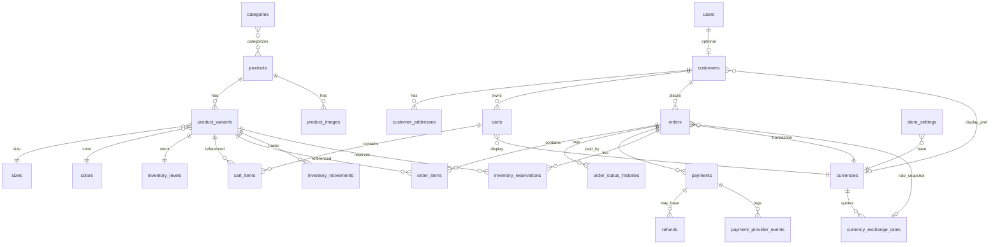

# Database design

Specification for the **single-store fashion e-commerce** application. Tier‑1 schema is implemented under `database/migrations/2026_03_20_*` (see [DATABASE_IMPLEMENTATION_REPORT.md](DATABASE_IMPLEMENTATION_REPORT.md)). **Domain ownership** is defined in [DOMAIN_DATA_OWNERSHIP.md](DOMAIN_DATA_OWNERSHIP.md).

**Conventions**

- Primary keys: `BIGINT UNSIGNED` auto-increment (`id`) unless noted.
- **Base catalog currency:** **USD** (ISO 4217). Variant list prices and admin-entered shipping baselines are stored in USD unless a column explicitly states otherwise.
- **Supported currencies:** **USD**, **EGP**, **KWD** — display and/or transaction (see [Currency model](#currency-and-exchange-rates-confirmed) below).
- **USD catalog amounts:** `DECIMAL(12, 2)` (`cart_items.unit_price_base`, variant `price`, USD shipping baselines).
- **Transaction-currency amounts** (orders, payments, refunds): `DECIMAL(19, 4)` — sufficient for **KWD (3)** and **USD/EGP (2)**; application rounds to `currencies.minor_units` for the row’s `currency_code` (never hardcoded).
- **Exchange rates:** `DECIMAL(18, 8)`; arithmetic uses decimal types, not floating point.
- **Historical immutability:** `orders`, `order_items`, `payments`, and `refunds` store the **transaction currency and amounts as charged**. Admin rate changes or default-currency config changes **must not** rewrite historical rows.
- Timestamps: `created_at`, `updated_at` (`TIMESTAMP NULL` or Laravel defaults) on mutable tables.
- Soft deletes: only where noted (products); variants use status instead.
- Charset: `utf8mb4` / `utf8mb4_unicode_ci` (MySQL).
- Existing Laravel tables (`users`, `password_reset_tokens`, `sessions`, `jobs`, `cache`) are unchanged in this design pass except **documented extensions** to `users`.

---

## Entity relationship overview



---

## Currency and exchange rates (confirmed)

| Rule | Decision |
| --- | --- |
| Default / base store currency | **USD** |
| Supported currencies | **USD**, **EGP**, **KWD** |
| Catalog variant `price` | Stored in **USD** (base) |
| EGP / KWD | Additional supported currencies — **display** (browsing) and **transaction** (checkout) via manual admin exchange rates |
| Display vs payment | Customer **display currency** does **not** automatically set **payment currency** |
| Checkout | Customer (or checkout flow) selects an **explicit supported transaction currency** |
| Orders & payments | Persist **transaction `currency_code`** and all monetary totals in that currency, plus frozen **exchange rate metadata** tied to USD base |
| Rate changes | New rate rows only; past orders unchanged |

**Conversion convention (design):** Exchange rates express **how many units of quote currency equal 1 USD**:

`display_amount = ROUND(usd_amount × rate, quote_minor_units)`  
e.g. `1 USD × 48.50 = 48.50 EGP`.

USD display uses rate `1.0` (no separate row required; application treats USD as identity).

### Rounding and conversion policy (**confirmed**)

**Precision** comes from `currencies.minor_units` (USD **2**, EGP **2**, KWD **3**). Conversion logic must **never** hardcode scale.

1. Use **decimal** arithmetic only (BCMath / SQL `DECIMAL`), never float.
2. **Half-up** round each monetary component to the transaction currency’s `minor_units`.
3. **Order of operations at checkout (Strategy C):** For each line, convert `unit_price_base_usd` → rounded `unit_price`; `line_subtotal = unit_price × qty` (or round line from USD subtotal—**use per-line rounded `unit_price` × qty**). Convert shipping (USD baseline) and tax (when enabled) once each; sum **rounded** `subtotal`, `discount_total`, `shipping_total`, `tax_total` into `grand_total` (no silent full-order re-round from USD).
4. Freeze `exchange_rate`, `currency_exchange_rate_id`, and `exchange_rate_effective_from` on the order row; amounts on `order_items` and `payments` match that snapshot.

Display cart totals use the **current** rate; cart lines stay USD base.

### `currencies`

Reference data for supported ISO 4217 codes. **Store** domain owns.

| Column | Type | Null | Default | Notes |
| --- | --- | --- | --- | --- |
| `code` | `CHAR(3)` | NO | — | PK, e.g. `USD`, `EGP`, `KWD` |
| `name` | `VARCHAR(64)` | NO | — | English admin label |
| `symbol` | `VARCHAR(16)` | NO | — | e.g. `$`, `E£`, `د.ك` |
| `minor_units` | `TINYINT UNSIGNED` | NO | `2` | Decimal places for display/charge |
| `is_base` | `TINYINT(1)` | NO | `0` | Exactly one `USD` = `1` |
| `display_enabled` | `TINYINT(1)` | NO | `1` | Shown in storefront currency switcher |
| `transaction_enabled` | `TINYINT(1)` | NO | `1` | Allowed at checkout / payment |
| `sort_order` | `SMALLINT` | NO | `0` | |
| `created_at` | `TIMESTAMP` | YES | NULL | |
| `updated_at` | `TIMESTAMP` | YES | NULL | |

**Seed (MVP):**

| code | minor_units | is_base | display_enabled | transaction_enabled |
| --- | --- | --- | --- | --- |
| USD | 2 | 1 | 1 | 1 |
| EGP | 2 | 0 | 1 | 1 |
| KWD | 3 | 0 | 1 | 1 |

**Indexes:** PK `(code)`.

### `currency_exchange_rates`

Manual admin-managed rates from **USD** → quote currency. **Append-only** for audit; “update” = insert new row with later `effective_from`.

| Column | Type | Null | Default | Notes |
| --- | --- | --- | --- | --- |
| `id` | `BIGINT UNSIGNED` | NO | auto | PK |
| `quote_currency_code` | `CHAR(3)` | NO | — | FK → `currencies.code`, not USD |
| `rate` | `DECIMAL(18, 8)` | NO | — | Quote units per **1 USD** |
| `effective_from` | `TIMESTAMP` | NO | — | Rate valid from this instant (UTC) |
| `notes` | `VARCHAR(255)` | YES | NULL | Admin note |
| `created_by_user_id` | `BIGINT UNSIGNED` | YES | NULL | FK → `users.id` |
| `created_at` | `TIMESTAMP` | NO | — | Immutable insert time |

**FK:** `quote_currency_code` → `currencies.code` ON DELETE RESTRICT.

**Indexes:** `(quote_currency_code, effective_from DESC)` for “current rate” lookup.

**Current rate rule:** Latest row per `quote_currency_code` where `effective_from <= NOW()` (application query).

**No `updated_at`:** Do not edit rates in place; insert a superseding row.


## Identity

### `users` (existing — extensions planned)

| Column | Type | Null | Default | Notes |
| --- | --- | --- | --- | --- |
| `id` | `BIGINT UNSIGNED` | NO | auto | PK |
| `name` | `VARCHAR(255)` | NO | — | Display name |
| `email` | `VARCHAR(255)` | NO | — | UNIQUE |
| `email_verified_at` | `TIMESTAMP` | YES | NULL | |
| `password` | `VARCHAR(255)` | NO | — | Hashed |
| `role` | `VARCHAR(32)` | NO | `customer` | `admin` \| `customer` (MVP) |
| `is_active` | `TINYINT(1)` | NO | `1` | Admin lockout |
| `remember_token` | `VARCHAR(100)` | YES | NULL | |
| `created_at` | `TIMESTAMP` | YES | NULL | |
| `updated_at` | `TIMESTAMP` | YES | NULL | |

**Indexes:** `UNIQUE (email)`, index on `(role)` for admin listings.

**Purpose:** Authentication subject for staff and registered shoppers. **Does not** store shipping addresses or order history (Customers / Orders domains).

**Assumption:** One guard (`web`); API reuses the same user model with session or token strategy decided at implementation (see [MVP_SCOPE.md](MVP_SCOPE.md)).

### `password_reset_tokens` / `sessions`

Laravel defaults. **Identity** owns; no business extensions for MVP.

---

## Customers

### `customers`

| Column | Type | Null | Default | Notes |
| --- | --- | --- | --- | --- |
| `id` | `BIGINT UNSIGNED` | NO | auto | PK |
| `user_id` | `BIGINT UNSIGNED` | YES | NULL | FK → `users.id`, UNIQUE when set |
| `email` | `VARCHAR(255)` | NO | — | UNIQUE; guest identity key |
| `first_name` | `VARCHAR(100)` | NO | — | |
| `last_name` | `VARCHAR(100)` | NO | — | |
| `phone` | `VARCHAR(32)` | YES | NULL | |
| `marketing_opt_in` | `TINYINT(1)` | NO | `0` | |
| `preferred_display_currency_code` | `CHAR(3)` | YES | NULL | FK → `currencies.code`; browsing only |
| `preferred_locale` | `CHAR(5)` | YES | NULL | FK → `store_locales.code` |
| `preferred_theme` | `VARCHAR(32)` | YES | NULL | FK → `store_themes.code` |
| `created_at` | `TIMESTAMP` | YES | NULL | |
| `updated_at` | `TIMESTAMP` | YES | NULL | |

**Foreign keys:** `user_id` → `users.id` ON DELETE SET NULL.

**Indexes:** `UNIQUE (email)`, `UNIQUE (user_id)`, index `(last_name, first_name)` optional for admin search.

**Purpose:** Shopper identity independent of login. Registered users: one customer row per `user_id`. Guests: row created at checkout (or lazily on first order) with `user_id` NULL.

### `customer_addresses`

| Column | Type | Null | Default | Notes |
| --- | --- | --- | --- | --- |
| `id` | `BIGINT UNSIGNED` | NO | auto | PK |
| `customer_id` | `BIGINT UNSIGNED` | NO | — | FK → `customers.id` |
| `label` | `VARCHAR(64)` | YES | NULL | e.g. Home |
| `first_name` | `VARCHAR(100)` | NO | — | |
| `last_name` | `VARCHAR(100)` | NO | — | |
| `phone` | `VARCHAR(32)` | YES | NULL | |
| `line1` | `VARCHAR(255)` | NO | — | |
| `line2` | `VARCHAR(255)` | YES | NULL | |
| `city` | `VARCHAR(100)` | NO | — | |
| `region` | `VARCHAR(100)` | YES | NULL | State/province |
| `postal_code` | `VARCHAR(20)` | NO | — | |
| `country_code` | `CHAR(2)` | NO | — | ISO 3166-1 alpha-2 |
| `is_default_shipping` | `TINYINT(1)` | NO | `0` | |
| `is_default_billing` | `TINYINT(1)` | NO | `0` | |
| `created_at` | `TIMESTAMP` | YES | NULL | |
| `updated_at` | `TIMESTAMP` | YES | NULL | |

**Foreign keys:** `customer_id` → `customers.id` ON DELETE CASCADE.

**Indexes:** `(customer_id)`, partial uniqueness enforced in app: one default shipping per customer (MVP application rule).

**Cardinality:** Customer 1 — * addresses.

---

## Store

Single-store configuration (one logical store, no `tenant_id`).

### `store_settings`

Singleton row pattern: application enforces `id = 1` (or single row via unique `singleton_key`).

| Column | Type | Null | Default | Notes |
| --- | --- | --- | --- | --- |
| `id` | `BIGINT UNSIGNED` | NO | `1` | PK |
| `store_name` | `VARCHAR(255)` | NO | — | |
| `contact_email` | `VARCHAR(255)` | NO | — | |
| `contact_phone` | `VARCHAR(32)` | YES | NULL | |
| `base_currency_code` | `CHAR(3)` | NO | `USD` | FK → `currencies.code`; catalog & cost baseline |
| `default_display_currency_code` | `CHAR(3)` | NO | `USD` | FK; new visitors / guests |
| `timezone` | `VARCHAR(64)` | NO | `UTC` | |
| `address_line1` | `VARCHAR(255)` | YES | NULL | Legal/returns address |
| `address_line2` | `VARCHAR(255)` | YES | NULL | |
| `city` | `VARCHAR(100)` | YES | NULL | |
| `region` | `VARCHAR(100)` | YES | NULL | |
| `postal_code` | `VARCHAR(20)` | YES | NULL | |
| `country_code` | `CHAR(2)` | YES | NULL | |
| `tax_enabled` | `TINYINT(1)` | NO | `0` | **Off until jurisdiction confirmed** |
| `prices_include_tax` | `TINYINT(1)` | NO | `0` | Display rule when tax enabled |
| `default_tax_rate` | `DECIMAL(5, 4)` | YES | NULL | Nullable until jurisdiction defined |
| `tax_configuration` | `JSON` | YES | NULL | Extensible: zones, classes, inclusive rules (future) |
| `shipping_enabled` | `TINYINT(1)` | NO | `1` | |
| `flat_shipping_amount` | `DECIMAL(12, 2)` | YES | NULL | MVP flat rate, stored in **USD** |
| `free_shipping_threshold` | `DECIMAL(12, 2)` | YES | NULL | Optional, **USD** |
| `order_number_prefix` | `VARCHAR(16)` | NO | `ORD` | |
| `reservation_ttl_minutes` | `SMALLINT UNSIGNED` | NO | `15` | Inventory |
| `guest_checkout_enabled` | `TINYINT(1)` | NO | `1` | |
| `default_locale` | `CHAR(5)` | NO | `en` | e.g. `en`, `ar` — Store language config |
| `default_theme` | `VARCHAR(32)` | NO | `light` | e.g. `light`, `dark` |
| `created_at` | `TIMESTAMP` | YES | NULL | |
| `updated_at` | `TIMESTAMP` | YES | NULL | |

**Purpose:** Minimum operational settings for storefront, checkout totals, locale/theme defaults, and jobs (reservation expiry).

### `store_locales`

Supported storefront languages. **Store** domain owns.

| Column | Type | Null | Notes |
| --- | --- | --- | --- |
| `code` | `CHAR(5)` | NO | PK, e.g. `en`, `ar` |
| `name` | `VARCHAR(64)` | NO | Admin label |
| `native_name` | `VARCHAR(64)` | NO | Display in switcher |
| `direction` | `VARCHAR(3)` | NO | `ltr` \| `rtl` |
| `is_active` | `TINYINT(1)` | NO | `1` |
| `sort_order` | `SMALLINT` | NO | `0` |
| timestamps | | | |

### `store_themes`

Supported UI themes (not product data). **Store** domain owns.

| Column | Type | Null | Notes |
| --- | --- | --- | --- |
| `code` | `VARCHAR(32)` | NO | PK, e.g. `light`, `dark` |
| `name` | `VARCHAR(64)` | NO | |
| `is_active` | `TINYINT(1)` | NO | `1` |
| `sort_order` | `SMALLINT` | NO | `0` |
| timestamps | | | |

Customer **active** locale/theme may also live in session/cookie until `customers` preference columns are added; allowed values must match these tables (validated by Store Actions).

### `shipping_methods` (post-MVP table — documented for extension)

| Column | Type | Null | Default |
| --- | --- | --- | --- |
| `id` | `BIGINT UNSIGNED` | NO | auto |
| `code` | `VARCHAR(64)` | NO | UNIQUE |
| `name` | `VARCHAR(255)` | NO | — |
| `amount` | `DECIMAL(12, 2)` | NO | — |
| `is_active` | `TINYINT(1)` | NO | `1` |
| `sort_order` | `SMALLINT` | NO | `0` |
| timestamps | | | |

**MVP:** Use `flat_shipping_amount` on `store_settings` only; add this table in a follow-up phase.

---

## Catalog

Fashion catalog uses a **parent product + sellable variants** model. Global **sizes** and **colors** are reusable lookup tables; each variant is one SKU (size/color combination actually sold).

### How multiple sizes and colors work

1. **Product** (`products`) = merchandising shell: title, description, default category, images that apply to all variants.
2. **Size** and **color** are normalized rows (`sizes`, `colors`) — e.g. S/M/L/XL and Navy/Black.
3. **Product variant** (`product_variants`) = one row per sellable SKU. Columns `size_id` and `color_id` define the matrix cell. Not every theoretical combination must exist (e.g. XL/Navy only).
4. Uniqueness: `UNIQUE (product_id, size_id, color_id)` with NULL semantics resolved in application: for “one size” products, use a dedicated size row `OS` (one size) or allow `size_id` NULL with partial unique index — **recommendation:** always use `sizes` including `OS` to avoid NULL in unique keys.
5. **Pricing:** `price` on variant is **always USD** (base); storefront may **display** converted EGP/KWD using Store exchange rates. Checkout converts to the **selected transaction currency** at place-order time.
6. **Images:** `product_images.product_id` for gallery; optional `product_variant_id` when a swatch image is color-specific.

```text
Product: "Linen Blazer"
  Variants:
    SKU BLAZER-NVY-S   size S,  color Navy,  price 199.00
    SKU BLAZER-NVY-M   size M,  color Navy,  price 199.00
    SKU BLAZER-BLK-M   size M,  color Black, price 209.00
```

### `categories`

| Column | Type | Null | Default | Notes |
| --- | --- | --- | --- | --- |
| `id` | `BIGINT UNSIGNED` | NO | auto | PK |
| `parent_id` | `BIGINT UNSIGNED` | YES | NULL | FK → `categories.id` |
| `name` | `VARCHAR(255)` | NO | — | |
| `slug` | `VARCHAR(255)` | NO | — | UNIQUE |
| `description` | `TEXT` | YES | NULL | |
| `sort_order` | `INT` | NO | `0` | |
| `is_active` | `TINYINT(1)` | NO | `1` | |
| `created_at` | `TIMESTAMP` | YES | NULL | |
| `updated_at` | `TIMESTAMP` | YES | NULL | |

**FK:** `parent_id` → `categories.id` ON DELETE SET NULL.

**Indexes:** `UNIQUE (slug)`, `(parent_id, sort_order)`.

### `category_product` (pivot)

| Column | Type | Null | Notes |
| --- | --- | --- | --- |
| `category_id` | `BIGINT UNSIGNED` | NO | FK → `categories.id` |
| `product_id` | `BIGINT UNSIGNED` | NO | FK → `products.id` |
| `is_primary` | `TINYINT(1)` | NO | `0` |

**PK:** `(category_id, product_id)`. **Indexes:** `(product_id)`.

### `sizes`

| Column | Type | Null | Default |
| --- | --- | --- | --- |
| `id` | `BIGINT UNSIGNED` | NO | auto |
| `code` | `VARCHAR(32)` | NO | UNIQUE e.g. S, M, L, OS |
| `label` | `VARCHAR(64)` | NO | Display |
| `sort_order` | `SMALLINT` | NO | `0` |
| `created_at` | `TIMESTAMP` | YES | NULL |
| `updated_at` | `TIMESTAMP` | YES | NULL |

### `colors`

| Column | Type | Null | Default |
| --- | --- | --- | --- |
| `id` | `BIGINT UNSIGNED` | NO | auto |
| `name` | `VARCHAR(64)` | NO | |
| `slug` | `VARCHAR(64)` | NO | UNIQUE |
| `hex_code` | `CHAR(7)` | YES | NULL | `#RRGGBB` |
| `sort_order` | `SMALLINT` | NO | `0` |
| timestamps | | | |

### `products`

| Column | Type | Null | Default | Notes |
| --- | --- | --- | --- | --- |
| `id` | `BIGINT UNSIGNED` | NO | auto | PK |
| `name` | `VARCHAR(255)` | NO | — | |
| `slug` | `VARCHAR(255)` | NO | — | UNIQUE |
| `description` | `TEXT` | YES | NULL | |
| `short_description` | `VARCHAR(500)` | YES | NULL | |
| `status` | `VARCHAR(32)` | NO | `draft` | `draft`, `published`, `archived` |
| `published_at` | `TIMESTAMP` | YES | NULL | |
| `brand` | `VARCHAR(128)` | YES | NULL | Optional |
| `created_at` | `TIMESTAMP` | YES | NULL | |
| `updated_at` | `TIMESTAMP` | YES | NULL | |
| `deleted_at` | `TIMESTAMP` | YES | NULL | Soft delete |

**Indexes:** `UNIQUE (slug)`, `(status, published_at)`.

**Publishing rule (confirmed):** A product may be **published** only when **both** `en` and `ar` rows exist in `product_translations` (and ≥1 active variant). Storefront reads **only** from `product_translations` for the active locale—**no** silent fallback to another language.

**Draft products** may use slug/status without complete translations; `products.name` is optional admin convenience only and is **not** used on the storefront when translations are missing.

### `product_translations`

Localized merchandising copy. **Catalog** domain owns.

| Column | Type | Null | Notes |
| --- | --- | --- | --- |
| `id` | `BIGINT UNSIGNED` | NO | PK |
| `product_id` | `BIGINT UNSIGNED` | NO | FK → `products.id` |
| `locale` | `CHAR(5)` | NO | FK → `store_locales.code` |
| `name` | `VARCHAR(255)` | NO | |
| `short_description` | `VARCHAR(500)` | YES | |
| `description` | `TEXT` | YES | |
| `created_at` | `TIMESTAMP` | YES | |
| `updated_at` | `TIMESTAMP` | YES | |

**Constraint:** `UNIQUE (product_id, locale)`.

**Order snapshots:** `order_items.product_name` and descriptions are copied at purchase time; translations on this table may change later without affecting past orders.

### `category_translations` (deferred — Tier 2)

Same pattern: `category_id`, `locale`, `name`, `description`. **Catalog** owns. MVP categories may use a single `categories.name` (admin English) until localization is extended.

### `product_variants`

| Column | Type | Null | Default | Notes |
| --- | --- | --- | --- | --- |
| `id` | `BIGINT UNSIGNED` | NO | auto | PK |
| `product_id` | `BIGINT UNSIGNED` | NO | — | FK → `products.id` |
| `sku` | `VARCHAR(64)` | NO | — | **Globally UNIQUE** |
| `size_id` | `BIGINT UNSIGNED` | NO | — | FK → `sizes.id` |
| `color_id` | `BIGINT UNSIGNED` | NO | — | FK → `colors.id` |
| `price` | `DECIMAL(12, 2)` | NO | — | Sell price in **USD** (base) |
| `compare_at_price` | `DECIMAL(12, 2)` | YES | NULL | Strike-through |
| `barcode` | `VARCHAR(64)` | YES | NULL | |
| `weight_grams` | `INT UNSIGNED` | YES | NULL | Shipping calc later |
| `status` | `VARCHAR(32)` | NO | `active` | `active`, `inactive` |
| `created_at` | `TIMESTAMP` | YES | NULL | |
| `updated_at` | `TIMESTAMP` | YES | NULL | |

**FKs:** `product_id` ON DELETE CASCADE; `size_id`, `color_id` ON DELETE RESTRICT.

**Constraints:** `UNIQUE (sku)`, `UNIQUE (product_id, size_id, color_id)`.

**Indexes:** `(product_id, status)`, `(sku)`.

### `product_images`

| Column | Type | Null | Notes |
| --- | --- | --- | --- |
| `id` | `BIGINT UNSIGNED` | NO | PK |
| `product_id` | `BIGINT UNSIGNED` | NO | FK → `products.id` |
| `product_variant_id` | `BIGINT UNSIGNED` | YES | FK → `product_variants.id`, color-specific |
| `disk` | `VARCHAR(32)` | NO | `public` |
| `path` | `VARCHAR(512)` | NO | |
| `alt_text` | `VARCHAR(255)` | YES | |
| `sort_order` | `SMALLINT` | NO | `0` |
| timestamps | | | |

**Indexes:** `(product_id, sort_order)`, `(product_variant_id)`.

### `product_attributes` / `product_attribute_values` (post-MVP)

For material composition, fit type, care instructions beyond size/color:

- **Definition** table: `code`, `name`, `value_type` (`text`, `select`).
- **Values** per product: `product_id`, `attribute_id`, `value_text` or `option_id`.

**MVP:** Use `products.description` and optional JSON column later; defer normalized attributes.

---

## Inventory

Stock is **per `product_variant_id`**. Catalog owns the variant; Inventory owns quantities and movements.

### `inventory_levels`

| Column | Type | Null | Default | Notes |
| --- | --- | --- | --- | --- |
| `id` | `BIGINT UNSIGNED` | NO | auto | PK |
| `product_variant_id` | `BIGINT UNSIGNED` | NO | — | FK → `product_variants.id`, **UNIQUE** |
| `quantity_on_hand` | `INT` | NO | `0` | Physical stock |
| `quantity_reserved` | `INT` | NO | `0` | Sum mirror; optional denorm |
| `low_stock_threshold` | `INT UNSIGNED` | YES | NULL | Alerts later |
| `version` | `INT UNSIGNED` | NO | `0` | Optimistic concurrency optional |
| `updated_at` | `TIMESTAMP` | YES | NULL | |

**Invariant (application + checks):** `quantity_on_hand >= 0`, `quantity_reserved >= 0`, `quantity_reserved <= quantity_on_hand`.

**Available to sell:** `quantity_on_hand - quantity_reserved` (or recompute from active reservations).

**FK:** `product_variant_id` ON DELETE RESTRICT (cannot delete variant with stock history without admin process).

### `inventory_movements`

Audit log of every quantity change.

| Column | Type | Null | Notes |
| --- | --- | --- | --- |
| `id` | `BIGINT UNSIGNED` | NO | PK |
| `product_variant_id` | `BIGINT UNSIGNED` | NO | FK |
| `type` | `VARCHAR(32)` | NO | See enum below |
| `quantity_delta` | `INT` | NO | Negative reduces on-hand |
| `quantity_on_hand_after` | `INT` | NO | Snapshot |
| `reference_type` | `VARCHAR(64)` | YES | `order`, `reservation`, `adjustment` |
| `reference_id` | `BIGINT UNSIGNED` | YES | Polymorphic id |
| `notes` | `VARCHAR(500)` | YES | |
| `created_by_user_id` | `BIGINT UNSIGNED` | YES | FK → `users.id`, admin adjustments |
| `created_at` | `TIMESTAMP` | NO | No `updated_at` (immutable) |

**Types:** `adjustment_in`, `adjustment_out`, `reservation_hold`, `reservation_release`, `sale_commit`, `return_restock` (return post-MVP).

**Indexes:** `(product_variant_id, created_at)`, `(reference_type, reference_id)`.

### `inventory_reservations`

| Column | Type | Null | Default | Notes |
| --- | --- | --- | --- | --- |
| `id` | `BIGINT UNSIGNED` | NO | auto | PK |
| `product_variant_id` | `BIGINT UNSIGNED` | NO | — | FK |
| `quantity` | `INT UNSIGNED` | NO | — | |
| `status` | `VARCHAR(32)` | NO | `active` | `active`, `committed`, `released`, `expired` |
| `cart_id` | `BIGINT UNSIGNED` | YES | NULL | FK → `carts.id` |
| `order_id` | `BIGINT UNSIGNED` | YES | NULL | FK → `orders.id` (set when order placed) |
| `expires_at` | `TIMESTAMP` | NO | — | From `store_settings.reservation_ttl_minutes` |
| `committed_at` | `TIMESTAMP` | YES | NULL | |
| `released_at` | `TIMESTAMP` | YES | NULL | |
| `created_at` | `TIMESTAMP` | YES | NULL | |
| `updated_at` | `TIMESTAMP` | YES | NULL | |

**Indexes:** `(product_variant_id, status)`, `(order_id)`, `(expires_at, status)`, `(cart_id)`.

**Cardinality:** Variant 1 — * reservations over time; sum(`quantity` where `status = active`) contributes to reserved qty.

---

## Cart

### `carts`

| Column | Type | Null | Default | Notes |
| --- | --- | --- | --- | --- |
| `id` | `BIGINT UNSIGNED` | NO | auto | PK |
| `customer_id` | `BIGINT UNSIGNED` | YES | NULL | FK → `customers.id` |
| `user_id` | `BIGINT UNSIGNED` | YES | NULL | FK → `users.id`, denorm convenience |
| `session_token` | `VARCHAR(64)` | YES | NULL | Guest cart key (hashed cookie value) |
| `base_currency_code` | `CHAR(3)` | NO | `USD` | Always USD for stored line prices |
| `display_currency_code` | `CHAR(3)` | NO | — | FK; customer browsing preference (USD/EGP/KWD) |
| `status` | `VARCHAR(32)` | NO | `active` | `active`, `converted`, `abandoned` |
| `expires_at` | `TIMESTAMP` | YES | NULL | Guest TTL |
| `created_at` | `TIMESTAMP` | YES | NULL | |
| `updated_at` | `TIMESTAMP` | YES | NULL | |

**Indexes:** `UNIQUE (session_token)` where not null (app-enforced), `(customer_id, status)`, `(user_id, status)`.

**Rules:** One active cart per customer or guest session (application enforcement).

### `cart_items`

| Column | Type | Null | Notes |
| --- | --- | --- | --- |
| `id` | `BIGINT UNSIGNED` | NO | PK |
| `cart_id` | `BIGINT UNSIGNED` | NO | FK → `carts.id` |
| `product_variant_id` | `BIGINT UNSIGNED` | NO | FK → `product_variants.id` |
| `quantity` | `INT UNSIGNED` | NO | min 1 |
| `unit_price_base` | `DECIMAL(12, 2)` | NO | Server snapshot in **USD** at add/refresh |
| `product_name` | `VARCHAR(255)` | NO | Snapshot |
| `sku` | `VARCHAR(64)` | NO | Snapshot |
| `variant_label` | `VARCHAR(255)` | NO | e.g. "M / Navy" |
| `created_at` | `TIMESTAMP` | YES | |
| `updated_at` | `TIMESTAMP` | YES | |

**Constraint:** `UNIQUE (cart_id, product_variant_id)`.

**Indexes:** `(cart_id)`.

---

## Checkout (MVP — no dedicated tables)

**Checkout** is an orchestration domain only. MVP persistence uses **`orders`** (with `idempotency_key`, `public_uuid`), **`payments`**, and **`inventory_reservations`**.

| Concern | MVP mechanism |
| --- | --- |
| Idempotent place order | `orders.idempotency_key` UNIQUE |
| Payment return URL correlation | `orders.public_uuid` (or `order_number`) in provider metadata |
| Transaction currency | `orders.currency_code` |
| Address snapshots | `orders.shipping_address` / `billing_address` JSON |
| Retry payment | New `payments` row (`attempt_number++`) on same order while reservation **active** and status `pending_payment` or `payment_failed` |

**Future (multi-step checkout):** If a long-lived draft checkout is needed (saved addresses across steps, abandoned checkout analytics), introduce `checkout_sessions` in a later phase without changing frozen order snapshots.

---

## Orders

Immutable commercial record after placement. Snapshots on lines and addresses.

### `orders`

| Column | Type | Null | Default | Notes |
| --- | --- | --- | --- | --- |
| `id` | `BIGINT UNSIGNED` | NO | auto | PK |
| `public_uuid` | `CHAR(36)` | NO | — | UNIQUE; public token for payment return URLs |
| `order_number` | `VARCHAR(32)` | NO | — | UNIQUE human-readable |
| `customer_id` | `BIGINT UNSIGNED` | YES | NULL | FK; guest orders nullable |
| `user_id` | `BIGINT UNSIGNED` | YES | NULL | FK denorm for auth scoping |
| `guest_email` | `VARCHAR(255)` | YES | NULL | Required if `customer_id` guest path |
| `status` | `VARCHAR(32)` | NO | `pending_payment` | See lifecycle |
| `base_currency_code` | `CHAR(3)` | NO | `USD` | Catalog reference; frozen |
| `currency_code` | `CHAR(3)` | NO | — | **Transaction** currency charged (USD/EGP/KWD) |
| `content_locale` | `CHAR(5)` | NO | — | FK → `store_locales.code`; locale used for product name snapshots |
| `exchange_rate` | `DECIMAL(18, 8)` | NO | — | Quote per 1 USD; `1.00000000` when `currency_code` = USD |
| `currency_exchange_rate_id` | `BIGINT UNSIGNED` | YES | NULL | FK → `currency_exchange_rates.id` (NULL for USD) |
| `exchange_rate_effective_from` | `TIMESTAMP` | YES | NULL | From rate row at order time |
| `subtotal` | `DECIMAL(19, 4)` | NO | — | Rounded; transaction currency |
| `discount_total` | `DECIMAL(19, 4)` | NO | `0.0000` | |
| `tax_total` | `DECIMAL(19, 4)` | NO | `0.0000` | `0` when tax not enabled |
| `shipping_total` | `DECIMAL(19, 4)` | NO | `0.0000` | |
| `grand_total` | `DECIMAL(19, 4)` | NO | — | Authoritative charge amount |
| `shipping_address` | `JSON` | NO | — | Snapshot |
| `billing_address` | `JSON` | NO | — | Snapshot |
| `customer_note` | `VARCHAR(500)` | YES | NULL | |
| `idempotency_key` | `VARCHAR(64)` | YES | NULL | UNIQUE |
| `placed_at` | `TIMESTAMP` | YES | NULL | When customer submitted |
| `paid_at` | `TIMESTAMP` | YES | NULL | |
| `cancelled_at` | `TIMESTAMP` | YES | NULL | |
| `created_at` | `TIMESTAMP` | YES | NULL | |
| `updated_at` | `TIMESTAMP` | YES | NULL | |

**Status values (MVP):** `pending_payment`, `payment_failed`, `processing`, `shipped`, `delivered`, `cancelled`, `refunded` (partial refund may stay `processing` with payment flags).

**Indexes:** `UNIQUE (order_number)`, `UNIQUE (public_uuid)`, `UNIQUE (idempotency_key)`, `(customer_id, created_at)`, `(guest_email)`, `(status, created_at)`.

**Payment retry (confirmed):** While `inventory_reservations` for this order are **active** and `status` ∈ (`pending_payment`, `payment_failed`), allow new `payments` attempts. If reservation **expires**, order moves to `cancelled` (or equivalent); customer must submit a **new** checkout with a new `idempotency_key` (new order).

**Guest orders:** `customer_id` set if a `customers` row exists; always store `guest_email` on guest checkout; `user_id` NULL.

### `order_items`

| Column | Type | Null | Notes |
| --- | --- | --- | --- |
| `id` | `BIGINT UNSIGNED` | NO | PK |
| `order_id` | `BIGINT UNSIGNED` | NO | FK → `orders.id` |
| `product_variant_id` | `BIGINT UNSIGNED` | YES | FK SET NULL if variant deleted |
| `product_id` | `BIGINT UNSIGNED` | YES | FK optional audit |
| `product_name` | `VARCHAR(255)` | NO | Snapshot |
| `sku` | `VARCHAR(64)` | NO | Snapshot |
| `variant_label` | `VARCHAR(255)` | NO | Size/color text |
| `quantity` | `INT UNSIGNED` | NO | |
| `unit_price_base_usd` | `DECIMAL(12, 2)` | NO | Catalog USD snapshot |
| `unit_price` | `DECIMAL(19, 4)` | NO | Rounded unit price in **transaction currency** |
| `line_subtotal` | `DECIMAL(19, 4)` | NO | `unit_price × quantity` |
| `tax_amount` | `DECIMAL(19, 4)` | NO | `0.0000` until tax jurisdiction implemented |
| `created_at` | `TIMESTAMP` | YES | No updates (immutable) |

**Indexes:** `(order_id)`, `(sku)`.

### `order_status_histories`

| Column | Type | Null | Notes |
| --- | --- | --- | --- |
| `id` | `BIGINT UNSIGNED` | NO | PK |
| `order_id` | `BIGINT UNSIGNED` | NO | FK |
| `from_status` | `VARCHAR(32)` | YES | NULL on create |
| `to_status` | `VARCHAR(32)` | NO | |
| `comment` | `VARCHAR(500)` | YES | |
| `actor_user_id` | `BIGINT UNSIGNED` | YES | Admin |
| `created_at` | `TIMESTAMP` | NO | Immutable |

**Indexes:** `(order_id, created_at)`.

---

## Payments

Provider-agnostic. **No** card numbers, CVV, or full PAN storage.

### `payments`

| Column | Type | Null | Notes |
| --- | --- | --- | --- |
| `id` | `BIGINT UNSIGNED` | NO | PK |
| `order_id` | `BIGINT UNSIGNED` | NO | FK → `orders.id` |
| `attempt_number` | `SMALLINT UNSIGNED` | NO | `1` for first try |
| `amount` | `DECIMAL(19, 4)` | NO | Must match `orders.grand_total` |
| `currency_code` | `CHAR(3)` | NO | Must equal `orders.currency_code` (transaction) |
| `status` | `VARCHAR(32)` | NO | `pending`, `authorized`, `captured`, `failed`, `cancelled` |
| `provider` | `VARCHAR(32)` | YES | NULL until selected e.g. `stripe` |
| `provider_payment_id` | `VARCHAR(128)` | YES | External id |
| `provider_checkout_url` | `VARCHAR(1024)` | YES | Redirect/hosted page |
| `idempotency_key` | `VARCHAR(64)` | NO | UNIQUE per attempt |
| `failure_code` | `VARCHAR(64)` | YES | |
| `failure_message` | `VARCHAR(500)` | YES | |
| `metadata` | `JSON` | YES | Non-sensitive provider payload |
| `authorized_at` | `TIMESTAMP` | YES | |
| `captured_at` | `TIMESTAMP` | YES | |
| `failed_at` | `TIMESTAMP` | YES | |
| `created_at` | `TIMESTAMP` | YES | |
| `updated_at` | `TIMESTAMP` | YES | |

**Indexes:** `(order_id, attempt_number)`, `UNIQUE (idempotency_key)`, `UNIQUE (provider, provider_payment_id)` where not null.

**Retries:** New row with incremented `attempt_number` or new idempotency key per retry policy.

### `payment_provider_events`

Idempotent webhook / callback log.

| Column | Type | Null | Notes |
| --- | --- | --- | --- |
| `id` | `BIGINT UNSIGNED` | NO | PK |
| `provider` | `VARCHAR(32)` | NO | |
| `provider_event_id` | `VARCHAR(128)` | NO | |
| `event_type` | `VARCHAR(64)` | NO | |
| `payment_id` | `BIGINT UNSIGNED` | YES | FK |
| `payload` | `JSON` | NO | Scrub sensitive fields before persist |
| `processed_at` | `TIMESTAMP` | YES | NULL until handled |
| `processing_result` | `VARCHAR(32)` | YES | `success`, `ignored`, `error` |
| `created_at` | `TIMESTAMP` | YES | |

**Constraint:** `UNIQUE (provider, provider_event_id)`.

### `refunds` (Tier 2 — schema reserved)

Admin/provider refunds after MVP launch. Same currency/immutability rules as `payments`. Not required for first migration batch.

---

## Relationship summary

| From | To | Cardinality | FK column |
| --- | --- | --- | --- |
| User | Customer | 1 : 0..1 | `customers.user_id` |
| Customer | Address | 1 : * | `customer_addresses.customer_id` |
| Customer | Cart | 1 : * | `carts.customer_id` |
| Customer | Order | 1 : * | `orders.customer_id` |
| Category | Product | * : * | `category_product` |
| Product | Variant | 1 : * | `product_variants.product_id` |
| Variant | Inventory level | 1 : 1 | `inventory_levels.product_variant_id` |
| Cart | Cart item | 1 : * | `cart_items.cart_id` |
| Cart item | Variant | * : 1 | `cart_items.product_variant_id` |
| Order | Order item | 1 : * | `order_items.order_id` |
| Order | Payment | 1 : * | `payments.order_id` |
| Order | Status history | 1 : * | `order_status_histories.order_id` |
| Variant | Reservation | 1 : * | `inventory_reservations.product_variant_id` |
| Currency | Exchange rate | 1 : * | `currency_exchange_rates.quote_currency_code` |
| Order | Transaction currency | * : 1 | `orders.currency_code` |
| Order | Exchange rate used | * : 0..1 | `orders.currency_exchange_rate_id` |
| Product | Translation | 1 : * | `product_translations.product_id` |

---

## Tax and shipping (MVP)

| Topic | MVP design |
| --- | --- |
| Shipping | `store_settings.flat_shipping_amount` in **USD**; converted + rounded at checkout |
| Tax | `tax_enabled` default **0**; `default_tax_rate` NULL; `tax_configuration` JSON for future rules. **Do not** assume a jurisdiction or rate until business confirms selling regions |
| Before tax implementation | Business must provide: selling countries/regions, B2C/B2B, VAT/sales tax IDs, inclusive vs exclusive display, product tax classes (if any) |

---

## Assumptions and unresolved items

| Item | Status |
| --- | --- |
| Languages `en` / `ar`; both translations required to publish | **Confirmed** |
| Themes light/dark; Store owns config + preference validation | **Confirmed** |
| USD base; USD/EGP/KWD; manual rates; immutable order/payment snapshots | **Confirmed** |
| `minor_units` USD 2, EGP 2, KWD 3; half-up; decimal math | **Confirmed** |
| Strategy C checkout; no provider HTTP in DB transactions | **Confirmed** |
| No `checkout_sessions` in MVP | **Confirmed** |
| `payment_failed` + retry while reservation valid | **Confirmed** |
| Tax jurisdiction and rates | **Unresolved** — business input required |
| Payment provider | **Unresolved** — must support chosen transaction currencies |
| Transaction currency at checkout | Must be enabled on currency **and** supported by provider |
| Category localization | Tier 2; single `categories.name` in MVP |
| `users.role` string vs permissions package | Open |
| Order fulfillment status transitions | Confirm with operations |

---

## Related documents

- [DATABASE_DESIGN_APPROVAL_REPORT.md](DATABASE_DESIGN_APPROVAL_REPORT.md)
- [DOMAIN_DATA_OWNERSHIP.md](DOMAIN_DATA_OWNERSHIP.md)
- [BUSINESS_WORKFLOWS.md](BUSINESS_WORKFLOWS.md)
- [MVP_SCOPE.md](MVP_SCOPE.md)
