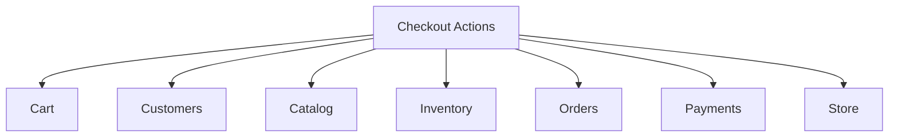

# Domain data ownership

Maps **business domains** to **tables**, **invariants**, and **cross-domain interaction patterns**. Aligns with [DOMAIN_MAP.md](DOMAIN_MAP.md) and [DATABASE_DESIGN.md](DATABASE_DESIGN.md).

**Principle:** A domain **owns** writes to its tables. Other domains invoke **public Actions** (commands) or react to **Events**; they do not embed another domain’s mutation rules in controllers.

---

## Ownership matrix

| Domain | Tables owned | Core invariants |
| --- | --- | --- |
| **Identity** | `users`, `password_reset_tokens`, `sessions` | Unique email; credential hashing; `role` for admin vs customer |
| **Customers** | `customers`, `customer_addresses` | Unique customer email; optional `preferred_locale`, `preferred_theme`, `preferred_display_currency_code` (logged-in persistence; guests use session/cookie via Store Actions) |
| **Store** | `store_settings`, `currencies`, `currency_exchange_rates`, `store_locales`, `store_themes`, (`shipping_methods` later) | USD base; USD/EGP/KWD; manual FX; locale/theme config; preference validation |
| **Catalog** | `categories`, `category_product`, `products`, `product_variants`, `product_translations`, `sizes`, `colors`, `product_images` | Unique SKU; **USD** prices; localized product copy; published products only sellable |
| **Inventory** | `inventory_levels`, `inventory_movements`, `inventory_reservations` | No negative on-hand; reserved ≤ on-hand; auditable movements |
| **Cart** | `carts`, `cart_items` | USD `unit_price_base` snapshots; `display_currency_code` for browsing; one active cart per identity key |
| **Checkout** | *(none in MVP)* | Orchestration only; persists via Orders, Payments, Inventory |
| **Orders** | `orders`, `order_items`, `order_status_histories` | Immutable snapshots; **transaction currency + amounts + `exchange_rate` frozen** |
| **Payments** | `payments`, `payment_provider_events`, `refunds` | Charge currency = `orders.currency_code`; amounts immutable; no sensitive card data |

Laravel infrastructure tables (`jobs`, `cache`, `failed_jobs`) are framework-owned, not business domains.

---

## Domain responsibilities (detailed)

### Identity

**Owns:** Authentication credentials and user lifecycle (activate/deactivate admin).

**Does not own:** Customer profile, addresses, carts, orders.

**Data:** Extend `users` with `role` (`admin` | `customer`) and `is_active`.

**Operations (future Actions):**

- `RegisterCustomerAction`, `AuthenticateUserAction`, `DeactivateUserAction` (admin).

**Admin vs customer:** Same `users` table; authorization via `role` and Policies. Staff never share a row with customer profile data—that lives on `customers`.

---

### Customers

**Owns:** Shopper identity and saved addresses.

**Relationship to Identity:**

- Registered shopper: `customers.user_id` → `users.id` (UNIQUE).
- Guest: `customers` row with email, `user_id` NULL created at or before first checkout.

**Guest → account linking (post-MVP flow, design now):**

1. Guest checks out → `customers` row keyed by email; `orders.customer_id` set.
2. User registers with same email → `LinkCustomerToUserAction` sets `user_id`, merges duplicate customer rows if any (careful uniqueness).
3. Order access: Policy checks `orders.user_id` or `orders.customer_id` linked to current user.

**Cross-domain:**

| Caller | Callee | Mechanism |
| --- | --- | --- |
| Checkout | Customers | `ResolveOrCreateCustomerAction` (email + address input) |
| Identity registration | Customers | `CreateCustomerForUserAction` |
| Orders (read) | Customers | Read-only via Policy + customer id; no direct address mutation |

---

### Store

**Owns:** Store-wide configuration, **currency catalog**, **USD → EGP/KWD exchange rates** (manual admin entry), **supported locales** (language configuration), and **supported themes** (including defaults). Validates and records **active customer preferences** for display currency, locale, and theme via domain Actions (persistence may use session/cookie/customer columns; rules and allowed values come from Store).

**Does not own:** Product translations (**Catalog**), checkout orchestration logic beyond settings (**Checkout**), or HTTP rendering.

**Confirmed currency rules:**

- **Base currency:** USD (catalog prices, `flat_shipping_amount`, `free_shipping_threshold`).
- **Supported:** USD, EGP, KWD (`currencies` reference; `display_enabled` / `transaction_enabled` flags).
- **Display currency:** Customer preference for browsing (session/cookie/cart/customer); **does not** imply payment currency.
- **Transaction currency:** Chosen explicitly at checkout; must be `transaction_enabled`.
- **Rates:** Append-only `currency_exchange_rates`; current rate = latest `effective_from <= now()` per quote currency.
- **Immutability:** Updating rates or `base_currency_code` in settings **never** backfills or alters `orders` / `payments`.

**Operations (planned):**

- `GetStoreSettingsQuery`, `UpdateStoreSettingsAction` (admin).
- `ListSupportedCurrenciesQuery`, `GetCurrentExchangeRateQuery` (USD → quote).
- `RecordExchangeRateAction` (admin insert; no in-place edit).
- `ConvertUsdToCurrencyAction` / `MoneyConverter` service (internal to Store; used by Cart, Catalog read models, Checkout).
- `SetDisplayCurrencyPreferenceAction`, `SetLocalePreferenceAction`, `SetThemePreferenceAction` (validate against Store config).

**Rounding:** `ConvertUsdToCurrencyAction` applies **half-up** rounding to the target currency’s `minor_units` per amount passed in; Checkout sums **already-rounded** line components when building order totals (see [DATABASE_DESIGN.md](DATABASE_DESIGN.md)).

**Cross-domain:**

| Caller | Callee | Mechanism |
| --- | --- | --- |
| Storefront HTTP | Store | Preference Form Request → Store Action → session/cookie; Cart `display_currency_code` via Cart Action |
| Catalog reads | Store | Convert USD variant price for PLP/PDP display |
| Cart | Store | Convert totals for cart UI (read-only); lines stay USD base |
| Checkout | Store | Resolve rate; validate transaction currency; pass rate snapshot to Orders |
| Orders | Store | **Read-only** at display time for old orders—use stored snapshots only |
| Payments | Orders | Currency and amount from order row, not live conversion |

---

### Catalog

**Owns:** All merchandising structure, **sellable SKU definitions**, and **product (and category) translations** per locale. Variant **`price` is always USD**.

**Does not own:** Exchange rates, display conversion, transaction totals, stock counts, storefront locale/theme configuration.

**Operations:**

- `CreateProductAction`, `PublishProductAction` (requires **`en` and `ar` `product_translations`** + active variants), `UpsertVariantsAction`, `AssignCategoriesAction`.
- `GetPublishedProductQuery`, `ResolveVariantForCartQuery` (USD price, title, sku, label, sellable flag).

**Cross-domain:**

| Caller | Callee | Mechanism |
| --- | --- | --- |
| Cart | Catalog | `ResolveVariantPricingAction` / Query when adding line (USD base) |
| Cart | Store | Display conversion for UI only |
| Inventory | Catalog | FK `product_variant_id` only; no catalog writes |
| Checkout | Catalog | Revalidate variants still published + prices |
| Orders | Catalog | Optional FK on `order_items`; snapshots are authoritative |

**Fashion note:** Adding a new size/color for a product = new `product_variants` rows + Inventory creates `inventory_levels` via `InitializeVariantStockAction` (Inventory), triggered from admin workflow.

---

### Inventory

**Owns:** `quantity_on_hand`, reservations, movement audit, and all reservation lifecycle invariants. **Checkout** coordinates when to call Inventory Actions; it does **not** own stock or reservation rules.

**Integration key:** `product_variant_id` (and `sku` for logging only).

**Operations:**

- `AdjustStockAction` (admin).
- `ReserveStockAction`, `ReleaseReservationAction`, `CommitReservationAction` (invoked from checkout/payment workflows).
- `ExpireReservationsJob` (scheduled).
- `GetAvailableQuantityQuery`.

**Reservation lifecycle (MVP, owned by Inventory):**

| Event | `ReleaseReservationAction`? | Notes |
| --- | --- | --- |
| Place order | No (hold) | `ReserveStockAction`; reservation `active` with TTL |
| Payment captured (verified) | No | `CommitReservationAction` |
| Payment declined / `payment_failed` | **No** | Reservation stays **active**; same order may retry payment while active |
| Order **cancelled** (customer/admin) | **Yes** | Release active reservations for that order |
| Reservation **TTL expired** | **Yes** | `ExpireReservationsJob`; typically cancels stale order |
| Late payment success after expiry | **No** auto-commit | Order already cancelled and stock released; **reconciliation** only—do not confirm order or commit stock ([BUSINESS_WORKFLOWS.md](BUSINESS_WORKFLOWS.md)) |

**Concurrency:** `ReserveStockAction` uses `DB::transaction()` + `SELECT ... FOR UPDATE` on `inventory_levels` for the variant (recommended MVP). Alternative: optimistic locking via `version` column with retry.

**Cross-domain:**

| Caller | Callee | Mechanism |
| --- | --- | --- |
| Checkout | Inventory | `ReserveStockAction` → returns reservation ids |
| Checkout / Payments (success path) | Inventory | `CommitReservationAction` after verified payment |
| Checkout / Orders (cancel) or Inventory (job) | Inventory | `ReleaseReservationAction` on **order cancellation** or **reservation expiry**—not on ordinary payment failure |
| Admin | Inventory | `AdjustStockAction` |
| Catalog admin | Inventory | Event `VariantCreated` → listener `InitializeVariantStockAction` **or** explicit admin “add stock” step |

**Recommendation:** Avoid Catalog calling Inventory directly; **admin “create variant” workflow** orchestrates Catalog then Inventory Actions in one HTTP controller calling two domain Actions.

---

### Cart

**Owns:** Cart aggregate and line snapshots (not authoritative for final checkout).

**Operations:** `GetOrCreateCartAction`, `AddCartItemAction`, `UpdateCartItemQuantityAction`, `RemoveCartItemAction`, `RefreshCartPricesAction`, `SetCartDisplayCurrencyAction`, `MarkCartConvertedAction`.

**Currency:** Persist `unit_price_base` (USD) on lines. `display_currency_code` on cart is **presentation**; checkout recomputes in **transaction currency**.

**Cross-domain:**

| Caller | Callee | Mechanism |
| --- | --- | --- |
| Cart | Catalog | Resolve variant price and labels on add/refresh |
| Checkout | Cart | Load cart, validate non-empty, convert after success |
| Storefront HTTP | Cart / Store | Controllers call Actions only—no business rules in views |

**Guest cart:** `session_token` on `carts`; on login, `MergeGuestCartAction` (Cart domain) may combine guest cart into customer cart.

---

### Checkout

**Owns:** Checkout **orchestration Actions** only (no MVP tables). **Does not** own long-term order, payment, or inventory rows (delegates to Orders, Payments, Inventory, Store).

**Operations:**

- `StartCheckoutAction` (addresses, validate cart, capture **transaction currency**).
- `PlaceOrderAction` (primary saga entry—see [BUSINESS_WORKFLOWS.md](BUSINESS_WORKFLOWS.md)); locks **exchange rate** onto order.
- `CompleteCheckoutAfterPaymentAction` (webhook/return handler entry).

**Cross-domain (all via Actions):**

**Avoid:** Checkout models updating `inventory_levels` directly; Orders creating payments without Payments Actions; **payment provider HTTP inside `DB::transaction()`**.

**Returns:** Actions yield DTOs (e.g. `PlaceOrderResult`); **HTTP controllers** map to Resources or Blade.

---

### Orders

**Owns:** Order aggregate, line item snapshots, status history.

**Operations:**

- `CreatePendingOrderAction` (from checkout DTO).
- `TransitionOrderStatusAction` (admin fulfillment).
- `CancelOrderAction` (rules: only certain statuses).
- `GetCustomerOrdersQuery`.

**Events (optional MVP):** `OrderPlaced`, `OrderPaid`, `OrderCancelled` for notifications—not for core consistency.

**Cross-domain:**

| Caller | Callee | Mechanism |
| --- | --- | --- |
| Checkout | Orders | `CreatePendingOrderAction` |
| Payments | Orders | `MarkOrderPaidAction` / status transition on capture |
| Admin | Orders | `TransitionOrderStatusAction` |
| Customer HTTP | Orders | Query + Policy |

Orders **never** update catalog prices or inventory directly.

---

### Payments

**Owns:** Payment attempts, provider references, webhook idempotency, refunds.

**Operations:**

- `InitiatePaymentAction` (create pending payment + provider session).
- `HandleProviderWebhookAction` (idempotent).
- `RecordPaymentFailureAction`.
- `CreateRefundAction` (admin, MVP-basic).

**Contract (when implementing):** `PaymentGatewayContract` with `createCheckoutSession`, `capture`, `refund`—bound in `AppServiceProvider`.

**Cross-domain:**

| Caller | Callee | Mechanism |
| --- | --- | --- |
| Checkout | Payments | `InitiatePaymentAction` |
| Webhook HTTP | Payments | `HandleProviderWebhookAction` → Orders on success |
| Admin | Payments | `CreateRefundAction` |

Payments confirms `amount` and `currency_code` against `orders.grand_total` and `orders.currency_code` server-side—never from client-submitted FX.

---

## Circular dependency prevention

| Risk | Mitigation |
| --- | --- |
| Orders ↔ Payments | Payments calls `Orders::TransitionOrderStatusAction`; Orders does not call gateway |
| Checkout ↔ Orders | One direction: Checkout creates order; Orders does not call Checkout |
| Catalog ↔ Inventory | Inventory never imports Catalog models in write paths; FK only |
| Cart ↔ Checkout | Checkout reads Cart; Cart unaware of Checkout |

---

## Events vs direct Actions

| Use Event | Use Action |
| --- | --- |
| Send email after order paid | Reserve stock during checkout |
| Low stock notification (future) | Create order |
| Analytics hook (future) | Commit reservation after verified payment |
| Audit fan-out (optional) | Adjust inventory |

MVP **critical path** uses **synchronous Actions** inside **short** database transactions for domain rows. **Payment provider API calls** run after commit. Events for notifications and async side effects only.

---

## Read access exceptions

AGENTS.md allows intentional read of another domain’s data when rules are not bypassed:

- Storefront product list: Catalog Query only.
- Admin order detail showing current variant link: Orders snapshot + optional Catalog read for “product still exists”.

No cross-domain **writes** outside owning Action.

---

## Currency configuration data structures (summary)

| Structure | Owner | Purpose |
| --- | --- | --- |
| `currencies` | Store | Supported codes (USD, EGP, KWD); base/display/transaction flags |
| `currency_exchange_rates` | Store | Manual USD→EGP, USD→KWD rates (append-only) |
| `store_settings.base_currency_code` | Store | USD baseline for catalog/shipping config |
| `store_settings.default_display_currency_code` | Store | Default browsing currency |
| `store_locales` / `store_themes` | Store | Supported languages and themes |
| `customers.preferred_display_currency_code` | Customers | Optional saved display preference |
| `carts.display_currency_code` | Cart | Active browsing currency |
| `orders.currency_code` + `exchange_rate` + `currency_exchange_rate_id` | Orders | Frozen commercial terms |
| `orders.public_uuid` | Orders | Payment return correlation (MVP) |
| `order_items.unit_price` + `unit_price_base_usd` | Orders | Charge amount + USD audit trail |

**Display vs transaction (enforced in Checkout):** A customer may browse in EGP and pay in USD (or the reverse). Only `transaction_currency_code` drives `CreatePendingOrderAction` totals and `InitiatePaymentAction`.

---

## Checkout without `checkout_sessions` (confirmed MVP)

- **Idempotency:** `orders.idempotency_key`, `payments.idempotency_key`, `payment_provider_events`.
- **Return URLs:** `orders.public_uuid` (or `order_number`) passed to the provider.
- **Evolution:** Add `checkout_sessions` only if multi-step draft checkout requires persisted state before an order exists.

---

## Related documents

- [DATABASE_DESIGN.md](DATABASE_DESIGN.md)
- [BUSINESS_WORKFLOWS.md](BUSINESS_WORKFLOWS.md)
- [MVP_SCOPE.md](MVP_SCOPE.md)
