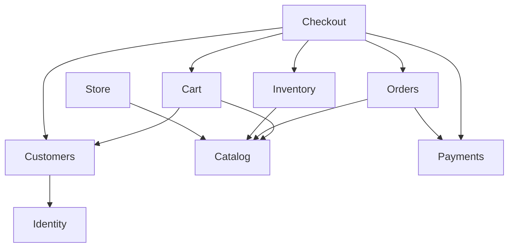

# Domain map

Business capabilities live under `app/Domains/{Name}/`. Subfolders appear when classes are added—not as empty scaffolding.

## Domain overview

Arrows indicate **logical dependency** (reads or orchestration), not PHP `use` statements. Prefer Actions and Events over deep model coupling.

## Per-domain responsibilities

### Identity

- Staff and customer authentication subjects (Laravel `User` today).
- Credentials, roles for admin vs customer (future), password reset integration.
- **Does not** own customer profile, addresses, or order history (**Customers** / **Orders**).

**Current code:** `App\Domains\Identity\Models\User`

### Customers

- Customer profile, preferences, address book.
- Links authenticated users to shopper identity where applicable.
- **Does not** perform payment or stock operations.

### Catalog

- Products, categories/collections, variants, size/color attributes.
- **Product translations** (`en`, `ar`); **both required before publish**; no storefront language fallback for product copy.
- SKU per variant, images, variant-level pricing in **USD** (base).
- Publishes product data for Cart and storefront; no stock counts, FX, or theme/locale configuration.

### Inventory

- Stock on hand per variant/SKU, low-stock signals (future).
- Reserve, release, and commit stock for checkout.
- **Collaboration:** accepts variant/SKU ids from Catalog; never redefines attributes.

### Cart

- Session or persisted cart, line items referencing catalog variants.
- Price snapshots on lines when added or refreshed.
- **Does not** place orders or charge cards.

### Checkout

- Orchestrates validation, stock, payment initiation, and order creation.
- Single place for the “place order” use case (`PlaceOrderAction` planned).
- **No MVP tables** — idempotency on `orders` / `payments`; correlation via `orders.public_uuid`.
- Uses **database transactions** for domain persistence; **does not** call payment providers inside those transactions (Strategy C).
- Payment/order step order is **provider-dependent** (see [BUSINESS_WORKFLOWS.md](BUSINESS_WORKFLOWS.md)).

### Orders

- Order aggregate, line items, statuses, fulfillment hooks.
- Immutable snapshots of product title, SKU, price at purchase.
- **Does not** own payment gateway protocol details.

### Payments

- Payment intents, captures, refunds, gateway adapters behind Contracts when needed.
- Idempotency keys and reconciliation with **Orders**.

### Store

- Single-store settings: name, branding, contact, tax/shipping baselines.
- **Base currency USD**; supported **USD, EGP, KWD**; manual **exchange rates**.
- **Supported locales** (e.g. en, ar), default locale, **supported themes** (e.g. light, dark), default theme.
- Actions to validate and persist **customer storefront preferences** (display currency, locale, theme)—HTTP controllers only delegate.
- **Does not** implement multi-tenant routing or own product translations.

## Cross-domain interaction table

| From | To | Interaction |
| --- | --- | --- |
| Checkout | Cart | Load cart, validate totals, clear after success |
| Checkout | Inventory | Reserve/commit stock per line SKU |
| Checkout | Payments | Authorize/capture; handle failure rollback |
| Checkout | Orders | Create order from cart snapshot |
| Checkout | Customers | Resolve shipping/billing addresses |
| Cart | Catalog | Resolve variant existence, price, title |
| Orders | Catalog | Read-only reference for admin; snapshots on order lines |
| Inventory | Catalog | SKU/variant id as foreign key only |
| Customers | Identity | Optional link `user_id` on customer record |
| Admin API/Web | All | Via HTTP → domain Actions only |

## Anti-patterns (reject in review)

- `Catalog` model importing `Orders` models to “show sales count” without a Query boundary.
- Duplicate “place order” logic in API and Admin controllers.
- Domain Actions returning API Resources, views, or HTTP responses.
- Business rules in Blade/views or controllers (FX, totals, stock, checkout).
- `Shared` folder growing domain-specific helpers.
- Repository interface per Eloquent model with no second implementation.

## Extension to other industries

Domains are named by **commerce capability**, not “fashion.” For another vertical:

- **Catalog** absorbs different attribute models (e.g. dimensions instead of apparel size).
- **Inventory** and **Checkout** remain structurally the same.
- **Store** branding and copy change; no tenant layer required.

## HTTP entry points (future)

| Channel | Example controller namespace |
| --- | --- |
| API | `App\Http\Controllers\Api\V1\*` |
| Storefront | `App\Http\Controllers\Web\Storefront\*` |
| Admin | `App\Http\Controllers\Web\Admin\*` |

All call the same domain Actions listed above, then map results to JSON (Resources) or Blade—Actions never return those formats.
