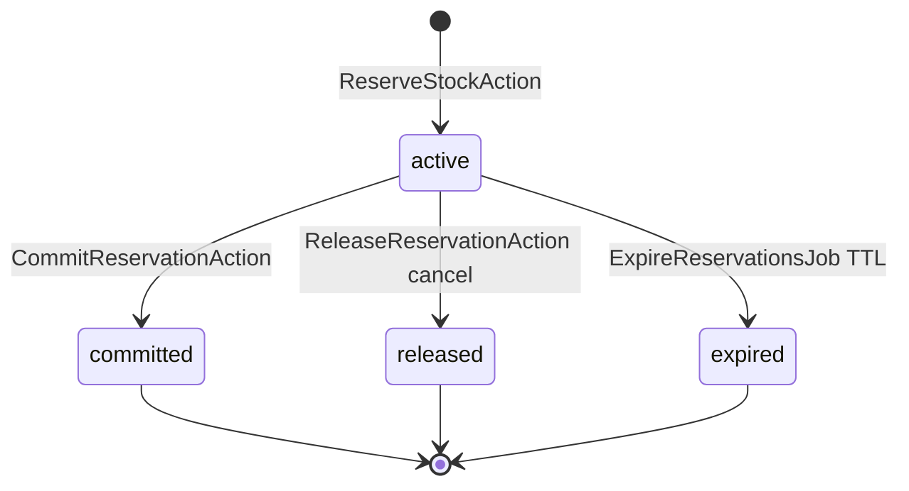

# Inventory reservation lifecycle design

**Date:** 2026-11-13
**Branch:** `feature/checkout-workflows`
**Status:** Design only (no implementation in this task)
**Companion:** [INVENTORY_RESERVATION_AUDIT_REPORT.md](INVENTORY_RESERVATION_AUDIT_REPORT.md)

Approved rules preserved: payment failure **does not** release reservations; retry on same order while **active**; release on **cancel** or **TTL expiry**; late capture → **reconciliation only** (no auto commit).

---

## 1. Quantity semantics

| Concept | Meaning | Storage |
| --- | --- | --- |
| **On hand** | Units physically in stock (not yet sold). | `inventory_levels.quantity_on_hand` |
| **Reserved (aggregate)** | Units held for active checkout/payment attempts. | `inventory_levels.quantity_reserved` |
| **Available** | Sellable now. | `on_hand - reserved` (after lock, before reserve) |
| **Reservation quantity** | Units in one hold row. | `inventory_reservations.quantity` |
| **Committed quantity** | Units sold (payment verified). | Reservation `status = committed`; on-hand reduced |
| **Released quantity** | Hold ended without sale (cancel). | Reservation `status = released` |
| **Expired quantity** | Hold ended by TTL job without sale. | Reservation `status = expired` |

**One counter, many rows:** `quantity_reserved` is maintained by Inventory Actions in the same transaction as reservation row changes. Sum of `active` reservation quantities should match the counter; mismatches indicate bugs or manual DB edits.

---

## 2. Lifecycle state transitions



| Transition | `inventory_reservations.status` | `quantity_on_hand` | `quantity_reserved` |
| --- | --- | --- | --- |
| **Reserve** | → `active` | unchanged | `+= qty` |
| **Commit** (paid) | `active` → `committed`, `committed_at` set | `-= qty` | `-= qty` |
| **Release** (cancel) | `active` → `released`, `released_at` set | unchanged | `-= qty` |
| **Expire** (TTL job) | `active` → `expired`, `released_at` optional | unchanged | `-= qty` |

**Payment failure:** no Inventory transition (stays `active`).

**Late payment after expiry:** reservation already `expired`/released — **do not** `CommitReservationAction`; Payments/ops reconciliation only.

---

## 3. Action responsibilities (minimal MVP set)

All Actions live under **`App\Domains\Inventory\Actions`**. They **must not** call `DB::commit()` when participating in an outer checkout transaction (see §4).

### 3.1 `ReserveStockForOrderLineAction` (or internal step of batch reserve)

**Owner:** Inventory.

**Input:** `product_variant_id`, `quantity`, `order_id`, optional `cart_id`, `expires_at` (UTC).

**Output:** `InventoryReservation` id (or DTO with id + qty).

**Steps (inside caller’s transaction):**

1. `InventoryLevel::query()->where('product_variant_id', $id)->lockForUpdate()->first()` (fail if no row → insufficient stock).
2. Assert `on_hand - reserved >= quantity`.
3. Insert `inventory_reservations` (`active`, FKs, `expires_at`).
4. Update `quantity_reserved += quantity`.
5. Insert `inventory_movement` type `reservation_hold`, `quantity_delta = 0`, `quantity_on_hand_after = current on_hand`, `reference_type = reservation`, `reference_id = reservation.id`.

**Failures:** insufficient stock → domain exception (rolls back outer tx); missing level row → same.

**Idempotency:** not at reservation row level; **PlaceOrderAction** idempotency on order prevents duplicate reserves.

### 3.2 `ReserveStockForOrderAction` (batch for place order)

**Owner:** Inventory (called by Checkout).

**Input:** list of `{ product_variant_id, quantity }`, `order_id`, `cart_id`, TTL minutes from `StoreSetting`.

**Behavior:**

- Sort variant ids **ascending**.
- Call line reserve for each distinct variant (aggregate qty if multiple cart lines same variant).
- **Any failure → exception**; outer transaction rolls back **entire** order + all prior lines in batch.

**Output:** list of reservation ids.

### 3.3 `CommitReservationAction`

**Owner:** Inventory (called by Payments success path).

**Input:** `reservation_id` or `order_id` (commit all `active` for order).

**Preconditions:** reservation `status === active`; payment/order state verified by caller.

**Steps:**

1. `lockForUpdate` on `inventory_levels` for variant.
2. If already `committed` → **no-op success** (idempotent).
3. Update reservation → `committed`, `committed_at = now()`.
4. `quantity_on_hand -= qty`; `quantity_reserved -= qty`.
5. Movement `sale_commit`, `quantity_delta = -qty`, `quantity_on_hand_after` updated, `reference_type = order`, `reference_id = order_id`.

**Failures:** not `active` (e.g. expired) → exception; caller must not mark order paid without reconciliation.

### 3.4 `ReleaseReservationAction`

**Owner:** Inventory.

**Input:** `reservation_id` or `order_id` (release all releasable `active` for order).

**Preconditions:** `active` only (not payment-failure auto-call).

**Steps:**

1. Lock level row.
2. If already `released` or `expired` → **no-op** (idempotent).
3. If `committed` → **reject** (illegal release).
4. Status → `released`, `released_at = now()`.
5. `quantity_reserved -= qty`.
6. Movement `reservation_release`, `quantity_delta = 0`, `quantity_on_hand_after` unchanged, `reference_type = reservation`.

### 3.5 `ExpireReservationsAction` (callable from job)

**Owner:** Inventory.

**Input:** optional `asOf` timestamp; processes `status = active` AND `expires_at < asOf`.

**Per reservation (own short transaction or chunked transactions):**

1. Lock level + reservation row (`lockForUpdate` on level; reservation by id).
2. If no longer `active` → skip.
3. Status → `expired`; decrement `quantity_reserved`; movement `reservation_release` (or dedicated note `expired` in `notes` field).
4. Return list of affected `order_id`s for Orders cancel coordination.

**Job:** `ExpireReservationsJob` schedules this + calls Orders cancel for stale orders (Checkout/Orders—not Inventory owning cancel rules).

### 3.6 `GetAvailableQuantityQuery` (optional)

**Input:** `product_variant_id`. **Output:** available int. Read-only; used by PrepareCheckout and revalidation.

---

## 4. Transaction and locking strategy

### Outer transaction (PlaceOrderAction)

```text
DB::transaction(function () {
    // idempotency, order, items, payment row
    ReserveStockForOrderAction::execute(...); // NO nested commit
});
```

**Rule:** Inventory Actions use the **default connection transaction** only. They **must not** wrap themselves in `DB::transaction()` when `$participatesInOuterTransaction === true` (constructor flag or method parameter). When invoked standalone (e.g. admin or job chunk), they may open their own transaction.

### MySQL locking

| Technique | Use |
| --- | --- |
| `lockForUpdate()` on `inventory_levels` | Serialize reserve/commit/release per variant |
| Sort variant ids ascending | Prevent deadlocks multi-line |
| Single outer transaction | All-or-nothing place order |

**Oversell prevention:** Available check and counter update occur **after** lock in the **same** transaction as order creation.

**Deadlock retry:** Optional application-level retry (1–2) on SQLSTATE 1213 for whole place-order transaction; not required in first implementation but document for HTTP layer.

**Indexes used:** unique `product_variant_id` on levels; `(product_variant_id, status)` on reservations for expiry queries.

---

## 5. Idempotency behavior

| Operation | Idempotency |
| --- | --- |
| Place order + reserve | `orders.idempotency_key` — replay returns existing order/reservations |
| Commit | If reservation already `committed` → success no-op |
| Release | If already `released`/`expired` → success no-op |
| Expire job | If not `active` → skip |
| Duplicate commit | Prevented by status guard + no double on-hand decrement |

---

## 6. Movement / audit behavior

| Type | When | `quantity_delta` | `quantity_on_hand_after` |
| --- | --- | --- | --- |
| `reservation_hold` | Reserve | `0` | unchanged on-hand |
| `reservation_release` | Release / expire | `0` | unchanged on-hand |
| `sale_commit` | Commit | `-qty` | new on-hand |
| `adjustment_*` | Admin | ±qty | updated (existing) |

`reference_type` / `reference_id` link to `reservation` or `order` as appropriate. Checkout system actions leave `created_by_user_id` null.

---

## 7. Checkout integration (`PlaceOrderAction`)

Sequence inside **one** database transaction (after preparation logic is duplicated or invoked):

1. Begin transaction (Checkout).
2. Idempotency lock / short-circuit if order exists.
3. Revalidate cart lines (catalog, stock availability — may call `GetAvailableQuantityQuery` without locking).
4. Create customer (if needed), pending order, order items, status history.
5. **`ReserveStockForOrderAction`** with `order_id`, `cart_id`, TTL from settings.
6. Create pending payment row.
7. Commit transaction.
8. **After commit:** payment provider only (no inventory).

**Linking:** Set `inventory_reservations.order_id` and optional `cart_id` on insert. No `orders.cart_id` column.

**PrepareCheckoutAction** remains read-only; place order must re-check stock under lock.

---

## 8. Failure and concurrency matrix

| Scenario | Expected behavior |
| --- | --- |
| Two customers reserve the final unit | Second transaction fails available check after `FOR UPDATE`; rolls back |
| Multi-item cart, one line unavailable | Entire `ReserveStockForOrderAction` fails; order not created |
| Same place-order idempotency replay | No second reserve; existing order returned |
| Commit called twice | Second call no-op on `committed` reservation |
| Release called twice | Second call no-op |
| Expire job runs twice on same row | Second pass skips non-`active` |
| Order transaction rolls back | No reservation rows, no movement, counters unchanged |
| Two txs lock variants in different cart orders | Consistent ascending lock order reduces deadlocks |
| Payment fails | Reservations stay `active` |
| Late payment after expiry | No commit; reconciliation; reservation already `expired` |

---

## 9. Test plan

### Unit / integration (SQLite acceptable)

| Test | Focus |
| --- | --- |
| Reserve success | counter +=, row `active`, movement hold |
| Reserve insufficient | exception, no row, counter unchanged |
| Multi-variant reserve | two variants, two rows |
| Rollback | simulate failed second line → no partial state |
| Commit | on_hand and reserved decrease, status `committed` |
| Release / expire | reserved decrease only, status terminal |
| Double commit / double release | idempotent no extra delta |
| GetAvailableQuantity | matches counter math |

Location: `tests/Unit/Domains/Inventory/` or `tests/Feature/Domains/Inventory/`.

### MySQL concurrency (recommended before production)

| Test | Focus |
| --- | --- |
| Parallel `ReserveStock` two processes | one succeeds, one fails |
| Place order parallel last unit | same |

Requires MySQL test connection (`phpunit.xml` env) or dedicated CI job; **SQLite cannot faithfully test `FOR UPDATE` races**.

### Checkout integration (later phase)

Place order + reserve inside transaction; idempotency replay; payment success commit path.

---

## 10. Incremental implementation plan

| Phase | Deliverable |
| --- | --- |
| **2a** | `GetAvailableQuantityQuery`, domain exceptions |
| **2b** | `ReserveStockForOrderAction` (+ line helper), movement writes, unit tests |
| **2c** | `CommitReservationAction`, `ReleaseReservationAction`, idempotent tests |
| **2d** | `ExpireReservationsAction` + `ExpireReservationsJob` skeleton |
| **2e** | MySQL concurrency test (if env available) |
| **3** (Checkout) | `PlaceOrderAction` calls reserve inside outer tx (separate task) |

---

## Final design verdict

**INVENTORY RESERVATION DESIGN READY FOR IMPLEMENTATION**

No migration changes required. Implement Actions with outer-transaction participation, pessimistic locks, and status-guarded idempotency on commit/release/expire.
