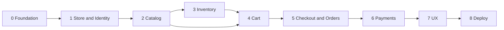

# Project roadmap

Phased implementation from foundation to production deployment. Adjust dates with the team; dependencies are technical.

## Phase 0 — Foundation (current)

**Goal:** Architecture, docs, Laravel wiring, empty domain boundaries.

- [x] Domain directories and HTTP layout
- [x] `AGENTS.md`, architecture docs
- [x] API route registration and sample health endpoint
- [x] Identity `User` under `app/Domains/Identity/Models/`
- [x] Team review of domain boundaries and checkout orchestration (see [DATABASE_DESIGN_APPROVAL_REPORT.md](DATABASE_DESIGN_APPROVAL_REPORT.md))

**Exit criteria:** `php artisan test` green; `route:list` shows web + API routes; no business migrations beyond Laravel defaults.

## Phase 1 — Store and Identity baseline

- Store settings model and admin/API read endpoints
- Customer registration/login (web + API) using Identity
- Roles: customer vs admin (policy skeleton)
- Base Blade layouts (`resources/views/layouts`, storefront/admin placeholders)

**Depends on:** Phase 0

## Phase 2 — Catalog (fashion)

- Products, variants, size/color attributes, SKU uniqueness
- Product images (storage strategy)
- Variant pricing fields
- Admin CRUD; API/storefront product listing and detail
- No stock mutation in Catalog

**Depends on:** Phase 1

## Phase 3 — Inventory

- Stock per variant/SKU
- Admin stock adjustments
- Read APIs for availability (storefront)

**Depends on:** Phase 2

## Phase 4 — Cart

- Guest and authenticated carts
- Add/update/remove lines; price snapshot rules
- Cart APIs and minimal storefront cart actions

**Depends on:** Phase 2–3

## Phase 5 — Checkout and Orders

- `PlaceOrderAction` with `DB::transaction()`
- Inventory reserve/commit integration
- Order creation with line snapshots
- Order history for customers; admin order list

**Depends on:** Phase 4

## Phase 6 — Payments

- Gateway Contract + first driver (team selects provider)
- Pay at checkout; failure paths with inventory release
- Admin refund hook (basic)

**Depends on:** Phase 5

## Phase 7 — Storefront and admin UX

- Fashion-oriented PLP/PDP, cart, checkout flow (web)
- Admin dashboards for catalog, orders, inventory
- API parity for mobile/headless clients

**Depends on:** Phase 6

## Phase 8 — Hardening and deployment

- Feature test coverage for Api/Web/Domains critical paths
- Queue workers for notifications and async payment webhooks
- CI pipeline, staging, production deploy runbook
- Observability (logging, health checks including `/api/v1/health`)

**Depends on:** Phase 7

## Diagram: phase flow

## Decisions requiring approval before coding

| Topic | Options | Recommendation |
| --- | --- | --- |
| Payment provider | Stripe, PayPal, regional gateway | Decide before Phase 6 |
| API auth | Sanctum, Passport, session token | Before Phase 1 API login |
| Cart persistence | DB vs Redis for guest | Before Phase 4 |
| Media | Spatie Media Library vs custom | Before Phase 2 images |
| Migrations in domain folders | Stay in `database/migrations` vs domain split | **Stay global** unless team disagrees |

## Non-goals (unless product changes)

- Multi-tenant SaaS
- Marketplace vendors
- ERP/WMS full integration in v1
