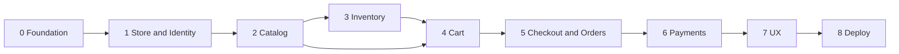

# Project roadmap

Phased implementation from foundation to production deployment. Adjust dates with the team; dependencies are technical.

## Phase 0 — Foundation (current)

**Goal:** Architecture, docs, Laravel wiring, empty domain boundaries.

- [x] Domain directories and HTTP layout
- [x] `AGENTS.md`, architecture docs
- [x] API route registration and sample health endpoint
- [x] Identity `User` under `app/Domains/Identity/Models/`
- [x] Team review of domain boundaries and checkout orchestration (see [DATABASE_DESIGN_APPROVAL_REPORT.md](DATABASE_DESIGN_APPROVAL_REPORT.md))

**Exit criteria:** `php artisan test` green; `route:list` shows web + API routes; no business migrations beyond Laravel defaults.

## Phase 1 — Store and Identity baseline

- Store settings model and admin/API read endpoints
- Customer registration/login (web + API) using Identity
- Roles: customer vs admin (policy skeleton)
- Base Blade layouts (`resources/views/layouts`, storefront/admin placeholders)

**Depends on:** Phase 0

## Phase 2 — Catalog (fashion)

- Products, variants, size/color attributes, SKU uniqueness
- Product images (storage strategy)
- Variant pricing fields
- Admin CRUD; API/storefront product listing and detail
- No stock mutation in Catalog

**Depends on:** Phase 1

## Phase 3 — Inventory

- Stock per variant/SKU
- Admin stock adjustments
- Read APIs for availability (storefront)

**Depends on:** Phase 2

## Phase 4 — Cart

- Guest and authenticated carts (implemented on feature branch — Milestone 9)
- Add/update/remove lines; price snapshot rules
- Cart APIs and minimal storefront cart actions

**Depends on:** Phase 2–3

## Phase 5 — Checkout and Orders

- `PlaceOrderAction` with `DB::transaction()`
- Inventory reserve/commit integration
- Order creation with line snapshots
- Order history for customers; admin order list

**Depends on:** Phase 4

## Phase 6 — Payments

- Gateway Contract + first driver (**OPEN-001**, **OPEN-005**)
- Post-commit initiation; webhook verification; retain Strategy C failure/retry semantics (**CHECKOUT-006–009**)
- Admin payment visibility read-only (**ADMIN-007**); refunds **Deferred** (**PAY-004**)

**Depends on:** Phase 5

### Milestone 11 — Mock payment + EGP/USD checkout (**MVP complete**)

**Delivered:** `PaymentGatewayContract`, `MockPaymentGateway`, post-commit `InitiatePaymentAction`, signed mock payment UI, storefront retry, EGP catalog base + EGP/USD checkout, read-only admin payment fields, tests ([MOCK_PAYMENT_IMPLEMENTATION_REPORT.md](MOCK_PAYMENT_IMPLEMENTATION_REPORT.md)).

**Still open:** Real provider (**OPEN-001**), merchant jurisdiction (**OPEN-005**), production webhooks and stale reconciliation (**PAY-005–007**). Refunds (**PAY-004**), manual admin capture (**ADMIN-007**).

## Phase 7 — Storefront and admin UX

- Fashion-oriented PLP/PDP, cart, checkout flow (web) — **storefront MVP largely complete**
- **Milestone 10:** Admin dashboards and CRUD for catalog, orders, inventory, customers, store config ([STORE_ADMINISTRATION_PLAN.md](STORE_ADMINISTRATION_PLAN.md))
- API parity for mobile/headless clients — deferred

**Depends on:** Phase 5 for admin; payment capture remains provider-only until Milestone 11 ships

### Milestone 10 — Store Administration (consolidated)

**Goal:** One admin area, one PR — WP1 auth shell through WP7 dashboard ([STORE_ADMINISTRATION_SCOPE.md](STORE_ADMINISTRATION_SCOPE.md)).

**Prerequisites:** Milestone 9 customer accounts; tier-1 schema; **ADMIN-001–010** and **CHECKOUT-014** **Approved** 2026-11-17; **OPEN-001**, **OPEN-003**, **OPEN-004** remain Open. Implementation must close the **expiry ↔ order cancel** gap documented under **ADMIN-006** §F.

## Phase 8 — Hardening and deployment

- Feature test coverage for Api/Web/Domains critical paths — **substantial Web/Unit coverage; API parity deferred**
- Queue workers for notifications and async payment webhooks — **deferred until real provider**
- CI pipeline, staging, production deploy runbook — **[DEPLOYMENT.md](DEPLOYMENT.md) added; CI not in repo**
- Observability (logging, health checks including `/api/v1/health`) — **health endpoint present**
- MySQL `@group mysql` concurrency tests — **authored; CI job `mysql-integration` in `.github/workflows/ci.yml`**
- DB-013 one-active-cart MySQL constraint — **implemented** (2026-11-18)
- Storefront catalog search — **implemented** (2026-11-18)

**Depends on:** Phase 7

## MVP status summary (2026-11-18)

| Category | Status |
| --- | --- |
| Storefront + admin MVP | **Complete** (mock payment) |
| Real payments | **Blocked** — OPEN-001, OPEN-005 |
| MySQL concurrency proof | **Not run** in default PHPUnit (SQLite) |
| Production deploy docs | **[DEPLOYMENT.md](DEPLOYMENT.md)** |
| Full completion report | **[FINAL_MVP_COMPLETION_REPORT.md](FINAL_MVP_COMPLETION_REPORT.md)** |

## Diagram: phase flow

## Decisions requiring approval before coding

| Topic | Options | Recommendation |
| --- | --- | --- |
| Payment provider | Stripe, PayPal, regional gateway | Decide before Phase 6 |
| API auth | Sanctum, Passport, session token | Before Phase 1 API login |
| Cart persistence | DB vs Redis for guest | Before Phase 4 |
| Media | Spatie Media Library vs custom | Before Phase 2 images |
| Migrations in domain folders | Stay in `database/migrations` vs domain split | **Stay global** unless team disagrees |

## Non-goals (unless product changes)

- Multi-tenant SaaS
- Marketplace vendors
- ERP/WMS full integration in v1
